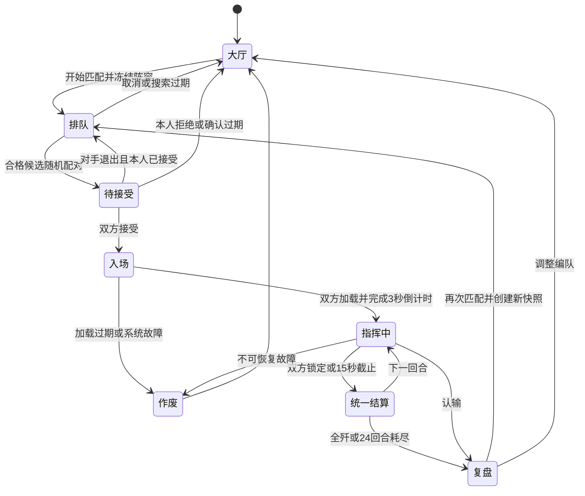

# 1v1 匹配演习设计

日期：2026-10-10。状态：已按首版范围接入本地游戏代码，完成定向测试与独立内存库双账号验收；尚未部署或迁移现有游戏数据库。交互原型保留用于设计评审，正式实现使用真实接口与战斗引擎。

时间规则更新：2026-10-20。匹配等待、业务租约、接受确认、入场、回合期限及冷却统一按持久化游戏时间计时，停服暂停，恢复后继续剩余时长；详见[停服暂停与恢复设计](SERVER_GAME_CLOCK.md)。

## 1. 模式定位

新增「对战 → 1v1 匹配演习」。玩家使用自己的军队编成、科技、部队配装和军官，与同一大区内实力接近、正在排队的真人玩家随机对战。用于练习机动、集火、射程控制和检验带兵将领技能。

采用英雄联盟、王者荣耀常见的体验顺序：演习大厅 → 开始匹配 → 独立匹配界面与等待计时 → 找到对手 → 双方接受 → 短暂入场 → 自动打开指挥面板 → 战斗复盘。接受对局后不再打开派兵、行军或军情页面。

首版为普通匹配，不做公开段位和赛季奖励。显示演习胜负记录，使用隐藏的指挥评分改善匹配。隐藏评分与真实军衔、声望、晋升考试、剿寇胜场分别保存。

## 2. 一场演习使用什么

| 项目 | 首版规则 |
| --- | --- |
| 兵力来源 | 排队时所选来源城市的自有、可用驻军；自选数量不超过现有数量与本城该将领带兵上限 |
| 快捷开始 | 默认选择上次编队；首次按可用战斗兵种比例选兵，并先展示阵容摘要；没有有效阵容时引导编成 |
| 带兵将领 | 可选一名属于本玩家、来源城市的合法带兵将领，也可不带将领；沿用已有出征候选资格和带兵上限，不允许司令官同时带队 |
| 司令官 | 来源城市司令部及其任命有效时，复制该司令官的四项有效属性；沿用现有常驻倍率，司令官技能不加入战斗 |
| 科技、装备 | 复制实际有效战斗科技、部队配装、将领装备/套装、将领战斗技能；不虚构满级加成 |
| 默认战术 | 演习独立预设，第一次从账号「出城默认战术」复制；双方均使用演习预设，与随机左右侧无关 |
| 战场类别 | 陆空战：陆军、空军；海空战：海军、空军。首版陆空战默认；空军单编归陆空战。禁止一场混入陆军与海军 |
| 支援及城防 | 不加入军团援军、碉堡、固定城防、城墙、仓库和地形一侧加成；双方均为野战军 |
| 后勤兵种 | 可随合法编队参战；至少有一个具备当前战场攻击能力的兵种，不能只派运输单位或零兵力 |
| 对手范围 | 同一游戏大区、同一战场类别、在线且主动排队的真人；军团或阵营不限制普通演习 |

点击「开始匹配」时，服务端在短事务内验证并复制完整阵容，生成 `snapshotId`、摘要和规则版本。排队和战斗使用同一份快照。编成修改需先取消排队，重新开始；找到对手后不能临时换兵、换将或换默认战术。

快照不预占真实部队、军官、装备或行军槽。排队后真实驻军增减、世界战斗伤亡、军官出征、切城或换装，不修改已经生成的演习副本。复制是一次读取，不代表派兵。演习中仍可处理真实世界事务；收到真实来袭时提供提示，玩家离开演习面板后本场继续默认托管。

## 3. 零消耗的硬边界

演习只写演习队列、会话、回合记录、演习战报和隐藏评分，不走真实行军/战损结算。禁止采用「先扣兵、战后返还」实现零消耗。

| 数据 | 演习行为 |
| --- | --- |
| 真实兵力、伤兵、战俘 | 无扣减、增加、伤兵回收或俘虏 |
| 粮食、石油、黄金及其他资源 | 不收报名费、不扣出征/战斗资源、不产生掠夺或物资收益 |
| 将领及装备 | 不产生死亡、受伤、被俘、经验或装备消耗；原有岗位、装备和所在城市不变 |
| 城市、保护、外交 | 不宣战、不触碰护盾，不改变城权、领地、驻军和军团关系 |
| 任务及晋升 | 不发送真实 `BATTLE_COMMAND`、战斗胜利、击杀等任务事件，不增加军衔声望、剿寇胜场或成就进度 |
| 演习记录 | 记录胜/负/平、指挥与托管回合、阵容和技能表现；可影响隐藏演习评分 |

技能里的补给、医疗、反击等战斗效果仍按现有引擎影响副本和日志，经济收益及真实伤兵/战俘结算关闭。面板、结果页始终标明「虚拟演习 · 实际兵力零损失」。

## 4. 实力接近且随机的匹配

### 4.1 两个匹配维度

`P` 为参战阵容的演习实力估值，包含兵种质量和数量、科技、配装、带兵将领有效属性与技能、司令官常驻倍率。`R` 为玩家的隐藏指挥评分，初始为1000。

军衔、账号等级、VIP、城建规模、仓库余额和未参战军官不直接参与计算。仅以总兵数匹配，会将大量步兵与少量重装备错误视为等价；仅以军衔匹配，也无法区分当前阵容和实际指挥能力。

`P` 是匹配估值，不进入伤害、命中、射程、胜负或战报结算，不能把它当作一方必胜的保证。首版采用可复算模型：

1. 兵种基础价值 `v_i = sqrt(max(1, 场景加权攻击_i) × 生命_i) × (1 + 防御_i / 100)`。陆空加权攻击取 `0.7 × 对地 + 0.3 × 对空`，海空取 `0.7 × 对海 + 0.3 × 对空`。这些权重是首版匹配参数，不改战斗领域属性。
2. 数量价值为 `Σ(数量_i × v_i)`。使用实战科技、配装及司令官倍率重新计算各兵种攻击、防御、生命；带兵将领军事、防御的周期属性按三回合均值估算。非线性伤害公式仍以战斗引擎为准。
3. 射程和机动修正取 `1 + min(0.20, 有效射程/10000) + min(0.10, 有效速度/100)`，按各兵种价值分别加权，防止无攻击的快运输单位单独抬高全军估值。
4. 带兵将领战斗技能修正 `K_skill` 从版本化校准表读取，按实际技能、等级及适用兵种计算；司令官技能和经济技能贡献为0。互相依赖的技能组合一起校准，不简单相加。
5. 最终 `P = round(Σ(数量_i × 有效价值_i × 射程机动修正_i) × K_skill)`。数值溢出、NaN、负数量和未知兵种由服务端拒绝，不能由客户端提交 `P`。

校准表是上线前必须完成的配置：使用当前引擎，对陆空/海空的步兵、装甲、远程、制空、混编/舰队等标准阵容，覆盖不同规模、科技、配装和技能等级，以固定种子、多样本、左右互换的自动演习结果检验模型。同估值阵容在参考阵容集合上的总体表现应相近，不要求互相克制的两种阵容一定五五开。没有完成校准时仅用于内部测试，不把初始系数宣称为实测公平性。

`powerModelVersion`、`battleRulesVersion` 与快照一起保存；排队估值可缓存，按快照哈希复用。不能在每轮匹配扫描里反复模拟所有候选对局。技能表和兵种规则变更后只影响新快照；旧会话继续冻结版本，规则发布前应先停止新入队并清空旧队列，确认兼容后再开放。

### 4.2 搜索窗口

以下为首版建议，后续根据真人等待时长及实力差分布调整：

| 本次连续排队时间 | 阵容实力差上限 | 指挥评分差上限 |
| --- | --- | --- |
| 0～29秒 | 10% | 100 |
| 30～59秒 | 15% | 150 |
| 60～119秒 | 20% | 200 |
| 120秒及以上 | 25% | 250 |

阵容实力差定义为 `max(Pa, Pb) / min(Pa, Pb) - 1`；两人必须同时满足各自的当前窗口，不能用等待较久者的宽窗口强行配给刚入队的人。战场类别、大区、版本和账号有效性始终是硬条件。

首次10场有效演习设为定级期，优先同定级期玩家；60秒后可进入普通玩家候选集合，仍受上述窗口限制，不把新手随意投放给高手。

匹配器每秒按最早排队者选锚点，在索引限定的同类别实力/评分窗口内取候选，按实力差、评分差、最近重复对手惩罚排序，从最合适的前5名中均匀随机选一名。双方认领成功后才能生成待接受对局；认领失败则重新读取候选。近期重复对手是软惩罚，120秒后仍可再遇见；最近5场连续重复对手只保留复盘，不更新评分，避免低人口环境相互刷分。

随机是合格候选中的随机，不是从全服玩家中随机抽取。不会匹配离线玩家、镜像玩家或把机器人伪装成真人。

120秒仍未找到时显示「当前合适对手较少，继续寻找中」，可继续等或取消。300秒结束本次搜索，提示重新匹配；不无限扩大实力差。预计等待只在近期有效样本足够时显示中位数和区间，否则显示「等待时间暂无法估计」。

### 4.3 隐藏评分

有效局使用 Elo 更新：`E = 1 / (1 + 10^((R对手-R自己)/400))`，`R新 = R旧 + K × (实际结果-E)`；胜、平、负分别为1、0.5、0，常规 `K=24`，定级 `K=40`，评分下限0。先保存双方旧值，在同一结算事务更新，不先更新一方再计算另一方。

双方均为人工、默认托管或混合指挥都算有效演习；默认托管是允许的玩法，不能因此判定挂机。未接受、入场失败、服务端作废和重复对手规则命中的局不更新评分。主动认输是负局，不能靠提前认输逃避评分；连续异常认输的刷分识别与评分修正列入运营规则。

## 5. 大厅、匹配及入场

### 5.1 大厅

大厅显示「1v1 匹配演习」、模式说明、战场类别、来源城市、当前兵种数量、带兵将领与司令官、演习实力估值、默认战术摘要、最近演习记录。

主按钮「开始匹配」，次操作「调整演习编队」「默认战术」「演习战报」。合法编队保存为演习专属配置，不改真实迎战编队。第一次显示简短说明：「本模式复制当前编队进行对战，不消耗真实兵力。未下令时自动执行默认战术。」

一个账号同一时间只允许一个队列或一场演习；多标签和多设备看到同一状态。已有对局时主按钮改为「返回演习战场」。

### 5.2 匹配界面

开始成功后立即切换到匹配界面：中央显示「正在寻找旗鼓相当的对手」和 `00:00` 等待时间，下方保留自己的阵容摘要，提供「取消匹配」。计时来自服务端 `queuedAt` 和 `serverTime`，刷新、切页面、多标签不会重新归零。

处于匹配时显示当前搜索阶段，扩大窗口时可提示「正在扩大搜索范围」。不展示陌生玩家名单或未匹配对手的完整快照。取消请求结果不明时重新查询状态，不能直接在客户端清空队列。

### 5.3 接受对局

找到对手后双方显示「匹配成功」，15秒内点击「接受对局」。接受阶段只显示战场类别、自己的阵容和「实力相近的对手」，暂不公开对方兵种/将领，减少挑阵容退出。

自己的接受状态可见；未接受前可取消。双方接受后原子进入入场，不再有取消匹配，退出应走战场认输。超时、拒绝或失联方离开队列；已经接受的一方自动重新排队，保留原等待起点，恢复为原冻结阵容。找不到对手时仍可取消。

普通排队取消无冷却；接受阶段连续3次未确认或拒绝，在10分钟窗口内触发60秒重新排队冷却。此规则只针对占用确认窗口，不针对正常默认托管。

### 5.4 入场

双方接受后自动打开战术指挥面板，顶部显示双方统帅、带兵将领、司令官和「虚拟演习」。战场立即显示阵地两端的部队；3秒入场倒计时后启动第1回合的15秒指挥窗口。没有世界地图行军和到达等待。

双方客户端通过幂等的 `loaded` 请求报告面板已加载；早到者显示「等待对手进入战场」。两人就绪后设置统一 `startsAt=serverNow+3000`。加载等待最多20秒，一方始终未加载则作废本局、不记胜负，已加载方回大厅；不会判离线方战损，也不会让客户端自行决定开始时间。

WebSocket用于提示，状态接口是权威恢复来源。刷新、断线重连、旧推送与推送丢失，都通过查询当前队列/会话恢复；服务器正常运行时，实际入场后玩家离线仍按默认战术继续。全服停服时暂停入场及回合计时，重启后按持久化的游戏时间和剩余窗口恢复。

## 6. 战场与指挥

### 6.1 初始站位与规则

双方随机分配内部A/B侧，A在 `x=0`，B在 `x=D`，各兵种开局均在自己的阵地底线，不添加前排偏移。每个玩家的面板将「我方」镜像到左侧；镜像只影响显示，服务端坐标不变。

当前普通战斗与演习规则均为`balance-v19-technology-20261016`。攻击、防御、生命、射程、火力密度均每级5%、满级50%；演习不加入城墙加固。

2026-10-16起，`D = 双方实际参战单位的最大有效射程 + 1850`，有效射程含各自武器射程科技；不再纳入速度、学识或机动技能，也不保证三回合安全窗口。前进、后退、待命、指定集火、底线、不能穿越存活敌军、有效射程与速度先手均复用世界战斗规则。真实结算中的 `attacker` / `defender` 在演习只代表引擎侧别，不代表进攻或守城特权。

保持24回合、每回合15秒。最长纯指挥等待约6分钟，另加入场、日志展示和网络时间。演示原型将回合缩短为5秒以方便评审；原型的伤亡与技能文字是流程示例，不能用作战斗平衡证据。

### 6.2 公平的双边提交

每回合分为「指挥中 → 已锁定 → 统一结算 → 下一回合」。所有玩家共享 `roundDeadlineAt`：

1. 指挥中按兵种选择前进/后退/待命，另选集火目标；未设置的兵种沿用自己的演习默认战术。
2. 选择命令立即保存为服务端私有草稿，页面显示「已保存」或「保存失败」。每方每回合草稿具有单调递增 `revision`；旧草稿不能覆盖新草稿。
3. 点击「锁定本回合指令」后本方不能修改，但不会单独推进回合。另一方只看到「对手已准备」，看不到指令、目标和草稿。
4. 双方已锁定则提前统一结算；截止时间到则自动锁定双方最后成功保存的草稿，缺项读取冻结的默认战术。全程无操作也能完成一场演习。
5. 回合结算只执行一次，先双方统一机动，再按当前引擎统一交火。结算完成后才向双方公开实际执行命令、坐标、伤亡和技能结果。

命令优先级为「该回合成功保存的人工命令 > 本场冻结的演习默认战术 > 兵种系统默认」。没有战斗自动前进标记的后勤单位默认待命；指定目标阵亡、非法或超射程时按现有索敌规则处理，不为追逐目标忽略射程。人工命令只作用于该回合，不悄悄延续到下一回合；持续行为应使用战前预设或明确「进入托管」。

「进入默认托管」会清除本人未锁定回合的人工草稿、按默认战术立即锁定本回合，并从下一回合起自动提交默认命令；随时可「接管下一回合」。已锁定/结算中的回合不能被接管撤销。关闭页面不等于认输；已经保存的草稿仍可在截止时使用，后续无人操作的回合执行默认战术。

截止时间是硬边界：请求按持有会话锁后的服务端时间判定，达到截止即拒绝新草稿。调度器延迟不延长可提交窗口。网络失败时先查询自己该回合的草稿/锁定状态，不自动重试未知结果的写请求。每个写请求带 `requestId` 与预期回合，重复请求返回原结果，旧回合返回冲突和当前状态。

### 6.3 对称胜负

不能直接继承世界攻城的「耗尽回合则守方获胜」。演习独立判定：

| 触发条件 | 结果 |
| --- | --- |
| 一方全部兵力归零，另一方尚存 | 尚存方胜利 |
| 双方同时归零 | 平局 |
| 一方主动认输 | 对方胜利；并发认输按服务端先提交的有效认输结算，后一个返回已结束 |
| 达到第24回合仍有双方部队 | 比较双方造成的「敌方初始兵力价值损失比例」；差值小于或等于5个百分点则平局，否则造成比例较高者胜利 |
| 服务端不可恢复错误、规则不兼容、入场失败 | 本局作废，不记胜负和评分 |

超时战果比例使用每个兵种冻结的基础价值 `v_i`：`造成损失比例 = Σ((敌方初始数量_i - 敌方剩余数量_i) × v_i) / Σ(敌方初始数量_i × v_i)`，限制在0～1。权重仅用开战时兵种基础配置，不能用战后属性重算，不混入战俘、真实伤兵、技能治疗/补给收益或生产资源。面板从开局展示「回合耗尽时按战果比例判定；差距≤5个百分点为平局」。

同射程同速度先手继续按回合轮换，首回合内部A/B随机分配并记录。左右对称测试应检查规则不会系统性偏向某侧，不要求每个随机样本伤亡完全一样。

## 7. 战后复盘

结果页显示胜/负/平或作废原因、演习用时、回合数、双方战果比例、初始与剩余虚拟兵力，并清晰显示「实际兵力损失：0」。提供「逐回合复盘」「调整编队」「再次匹配」。再次匹配生成新快照，重新核验当前真实阵容，不能复用过期驻军上限。

演习战报独立于真实战争战报：标记 `mode=PVP_PRACTICE`，自己的演习记录页保存双方参战快照，默认保留最近50场。只允许参战双方查看；不泄漏对方仓库、城市坐标、未参战军官、其他配装或账号完整资料。

技能检验必须基于引擎结构化事件，不能只解析日志字符串后猜测贡献：

| 复盘信息 | 展示目的 |
| --- | --- |
| 首次交战回合E、技能生效窗口E/E+3/E+6… | 解释为何尚未触发、为何本回合未生效 |
| 带兵将领军事/防御属性与技能统一生效于E/E+3/E+6… | 首次交火E起算，间隔两个回合关闭 |
| 每个技能的生效回合、影响对象、效果数值 | 查看冲锋、坚守、压制、破甲、反击、学习/借甲等实际事件 |
| 未生效原因 | 无带兵将领、非技能窗口、尚未交战、无适用单位、无同名参考对象、无有效射程目标等 |
| 司令官姓名、四项常驻倍率 | 明确司令官常驻属性来自何处，技能不参与 |
| 每回合指令来源、集火目标、移动及交火距离 | 区分人工、已保存草稿、默认托管，复盘拉扯与空过回合 |
| 参战单位的有效属性、科技及配装快照 | 检验战前换装/技能组合实际进入了哪一场 |

可显示直接额外伤害、反击伤害、受到的减伤等引擎可记录事件；不将它们解释为「该技能贡献了多少胜率」。多个倍率组合、目标改变和先手会产生交互，准确的单技能胜率贡献需要另外的对照实验。

## 8. 服务端数据与接口草案

### 8.1 独立持久化

建议新增 `PvpPracticeController`、`PvpMatchService`、`PvpPracticeService` 与独立调度器。先沿用现有MySQL事务、JPA版本字段和提交后WebSocket推送，无需为了首版引入Redis。

| 数据对象 | 主要字段 |
| --- | --- |
| `pvp_player_states` | `playerId`主键、唯一 `activeTicketId`/`activeSessionId`引用、状态、演习默认编队/战术、隐藏评分、定级场次、确认退出计数/窗口/冷却、`version` |
| `pvp_match_tickets` | 玩家、大区、战场类别、完整快照、`snapshotHash`、P/R与模型版本、`queuedAt`、确认截止/本人接受状态、待接受`sessionId`、`leaseUntil`、状态、`version` |
| `pvp_practice_sessions` | 两个参战玩家、双方冻结快照、A/B侧别、加载状态/截止、`startsAt`、当前回合/截止、双方默认托管状态、虚拟剩余军队/坐标、`firstCombatRound`、规则版本、随机种子/状态、结果、`settledAt`、`version` |
| `pvp_round_orders` | 唯一`(sessionId, round, playerId)`、命令草稿、revision、locked/锁定时间、指令来源、requestId、`version` |
| `pvp_round_results` | 唯一`(sessionId, round)`、前后状态摘要、实际命令与来源、结构化战斗/技能事件、回合随机子种子 |
| `pvp_practice_reports` | 唯一`(sessionId, playerId)`、双方开战快照、本人视角结果、战果比例、复盘事件、规则版本 |

票据确认阶段仍保留自己的记录与配对会话。拒绝/超时后关闭旧配对，重新排队时给已接受者生成新的票据ID并保留`queuedAt`，因此旧取消、接受与推送不能影响新票据。账号状态引用在同一事务更新，避免两个标签同时建队或重复配对。

账号状态仅是演习占用记录，不锁住真实部队。匹配时先按玩家ID升序锁两条演习状态，再锁票据、会话；创建快照时读取真实数据需要的账号/城市锁应在独立短事务内完成，不在队列等待期间持有锁。调度器、取消、接受、认输和回合提交沿用一致锁顺序，避免循环等待。

### 8.2 API

所有接口沿用现有鉴权与大区校验，从登录态取得玩家ID，不接受客户端指定自己的参战身份。

| 方法与路径 | 行为 |
| --- | --- |
| `GET /api/game/pvp/lobby` | 当前阵容预览、演习记录摘要、账号演习状态；仅自己的资料 |
| `POST /api/game/pvp/preset` | 保存演习独立编队/默认战术；已排队或对局中禁止覆盖当前快照 |
| `POST /api/game/pvp/queue` | `{requestId, citySlot, battlefield, army, commanderId, presetVersion}`；服务端验证、冻结、计算估值并入队 |
| `GET /api/game/pvp/status` | 权威状态、`serverTime`、ticket/session、相关截止与本人接受/加载状态；用于恢复和轮询 |
| `POST /api/game/pvp/queue/cancel` | `{requestId, ticketId}`；取消指定有效票据，已双确认时返回当前会话 |
| `POST /api/game/pvp/accept` | `{requestId, ticketId, sessionId}`；本人确认，幂等且检查确认截止 |
| `POST /api/game/pvp/loaded` | `{requestId, sessionId}`；确认指挥面板就绪 |
| `GET /api/game/pvp/battle?sessionId=...` | 参战双方才能读；返回我方/敌方视角、本人草稿及准备状态，不返回对手未结算指令 |
| `POST /api/game/pvp/orders` | `{requestId, sessionId, round, revision, orders, lock}`；保存本人草稿或锁定，不能单方推进回合 |
| `POST /api/game/pvp/auto` | `{requestId, sessionId, expectedRound, enabled}`；进入托管或请求下一回合接管 |
| `POST /api/game/pvp/surrender` | `{requestId, sessionId}`；只结束虚拟会话 |
| `GET /api/game/pvp/reports` | 本人演习战报分页 |
| `GET /api/game/pvp/report?sessionId=...` | 双方参战者查看同一场复盘 |

统一响应带`status`、`version`、`serverTime`，其中`serverTime`是服务器游戏时间；HTTP另以`X-Game-Time`返回样本，WebSocket以`gameTime`同步。客户端统一通过`G.GameTime`／`G.gameNow()`计算倒计时，不按本机墙钟外推；失联保留最后样本，重连查询当前状态。WebSocket原`timestamp`仍为真实时间，不可混作活动时钟。API不可把JPA实体直接序列化给玩家。前端不自动重试写请求；结果不明时先查询，再由用户明确重新执行并复用原`requestId`。

提交事务后通过 `WebSocketPushService.pushToPlayer` 分别发送 `pvpQueueChanged`、`pvpMatchFound`、`pvpAccepted`、`pvpBattleReady`、`pvpRoundResolved`、`pvpFinished`。每条事件带会话/票据ID、版本和玩家视角数据；推送丢失时，队列用3秒、战场用2秒的只读降级轮询，恢复WebSocket后停止。旧会话事件不能切走新会话或其他大区页面。

### 8.3 调度与故障恢复

- 匹配调度器每秒处理最早排队票据，限定批次，按大区/类别/状态/P/R索引查候选，禁止每秒加载所有玩家和军官。
- 排队/接受阶段客户端每10秒真实时间发送续约心跳；30秒业务租约按游戏时间计算，到期且没有有效续约才移出队列或结束待接受配对。停服不消耗租约剩余时间，刷新在租约内通过状态查询恢复。战斗阶段没有排队租约，服务器正常运行时断线继续默认托管。
- 接受/入场/回合调度器分别按截止索引扫描；多调度实例共享会话锁和唯一回合结果约束。终局战报、评分、占用释放同一事务完成，以`settledAt`防重复。
- 随机击杀存在于现有引擎。新演习使用每场独立随机上下文，持久化基础种子并由回合派生子种子，禁止依赖全局共享随机序列；同输入重试必须能复算同一结果。复盘直接读已保存结果，不用最新规则重跑历史。
- 服务重启先恢复全区游戏时钟，再读取持久化队列、确认截止和会话；未到期窗口继续剩余游戏时长，既不扣除停机时长，也不重置为完整15秒。只有在游戏时间上已经到期的回合才使用最后保存草稿或默认战术推进，每次最多恢复4回合；仍有积压时标记`RECOVERING`并拒绝新草稿，恢复后重同步当前回合。全服停机本身不会积累应补跑回合。
- 不因真实停机时长作废会话。现有`OUTAGE_TOO_LONG`保护判断的是游戏时间相对会话截止时间积压超过1小时，用于服务器游戏时钟仍在推进但会话结算长期落后的异常，不能解释为全服停机1小时就作废。冻结规则不兼容、账号不可用或引擎数据错误仍按既有异常路径作废，释放两人演习占用，不改真实兵力，不凭空授予胜负。

## 9. 现有代码的复用与必须改变的接口

下列判断来自2026-10-10工作区当前源代码；设计不是现有实现声明。

| 现有位置 | 可复用内容 / 边界 |
| --- | --- |
| `BattleService.calcInitialDistance` | 实际兵种、科技与司令官参与的动态距离 |
| `BattleService.resolveWorldRound` | 双边机动、交火、集火、科技/配装、技能及司令官计算；需抽出支持中立终局策略、结构化事件及独立随机上下文的共享内核 |
| `BattleRoundState` | 当前仅有`finished`和`attackerWin`；演习需独立WIN/LOSS/DRAW/VOID结果，不能用`!attackerWin`代表所有另一方结果 |
| `MarchService.executeTacticalRound` | 当前单方提交就结算且另一方用默认，并可能接受调度结算前的晚到指令；不能原样用于双边公平匹配 |
| `MarchService.settleTacticalBattle` | 真实战损、援军、战俘、奖励、城权和返程；演习禁止调用 |
| `BattleSession` | 当前`marchId`非空且唯一，关联真实行军；演习使用独立实体，不伪造March、不塞负数ID |
| `BattleActionPreferences` | 可读取现有出城默认战术作为首次预设；排队时拷贝，不在每回合读取变化中的真实账号设置 |
| `frontend/js/battle.js` | 抽出可复用战场地图、范围、标记、单位命令与司令官展示；演习增加双边准备/锁定状态、认输/托管和独立接口适配 |
| `frontend/js/api-client.js`、`ws-client.js` | 沿用账号/大区请求隔离、错误处理和提交后事件恢复；新增`Game.Pvp`模块 |

世界战斗保留现有真实结算与攻城超时规则。共享内核通过显式`WORLD`/`PVP_PRACTICE`终局策略选择行为；演习调度器只处理演习表，真实`TacticalBattleScheduler`继续只处理真实会话。

新增迁移应在实施时检查目录并使用下一未占用版本；当前工作区已存在V86，不能改写已应用迁移，也不在设计阶段先占用版本号。

## 10. 状态转换

## 11. 实施顺序和验收

首版完整范围是：演习编队/默认战术、实力模型校准、真人随机匹配、匹配计时与取消、双确认、自动进入指挥、双边统一结算、默认托管、对称终局、演习复盘、刷新恢复与零消耗验证。公开排位、好友约战、观战、跨服、回放动画和独立人机练习为后续扩展，不混入第一版队列。

先实现独立演习服务与零消耗契约，再建立队列/确认状态机、双边命令与推送恢复，最后接大厅/面板及结构化复盘。阵容模型需要与当前兵种及技能一起校准；匹配效率及公平性应在真实人口数据上继续观测。

验收至少覆盖：

1. 两个在线测试账号能从大厅进入同一场演习，匹配等待计时可取消、刷新保持；无人排队时不会出现假真人。
2. 实力差和评分差必须同时满足双方窗口；随机只在合格候选中发生，其他大区和战场类别不能混排。
3. 多标签并发入队/取消/接受、匹配器与取消竞态、迟到旧票据请求均不会生成两场演习或误取消新队列。
4. 双方接受后自动开指挥面板，初始所有单位分列两端，右侧玩家镜像展示正确，回合与倒计时一致。
5. 单方锁定不推进回合、不公开指令；双方锁定或截止恰好结算一次，非法/越权/旧回合/过期命令被拒绝。
6. 双方均零操作、单方离线、途中关闭页面仍可按各自冻结默认战术完成；保存草稿后断线仍执行成功保存的命令；保存失败则清晰提示并默认兜底。
7. 默认托管不判挂机；接管只从可修改回合起生效。匹配确认超时、入场失败、战斗认输与系统作废分别按约定处理。
8. 完整演习、认输、重复终局、异常回滚和重启恢复之后，真实兵力/资源/伤兵/战俘/军官/装备/城市/任务/声望/晋升记录与演习前完全相同；测试关闭经济Tick或隔离正常世界变化，不能把自然产量当作演习写入。
9. 带兵技能沿用E/E+3周期，司令官四属性常驻且技能排除；开战后换城/换任/换装不改变副本。模型估值不进入伤害计算。
10. 相同存活战果达到24回合应平局；交换A/B不会带来固定守方超时胜利。随机种子与回合输入重试可复算，左右镜像不改变胜负。
11. 复盘仅包含参战信息，未结算对手命令和非参战资产不通过接口/推送泄漏；技能无效原因来自实际结构化事件。
12. 指定并发规模下测量队列查询成本、有效匹配等待分布、P/R差分布、左右胜率、回合截止延迟及作废率；不在没有测量前承诺排队时长。

正式实现已新增独立演习接口、持久化实体、V87迁移、匹配与回合调度、游戏内大厅和指挥复盘。迁移仅在隔离测试中验证，尚未应用于现有游戏数据库，也没有执行部署。

### 11.1 设计交付验证

交互原型已完成JavaScript语法检查、片段渲染及23项定向流程断言，覆盖取消、排队/确认/入场、宿主状态回传、指令保存、双边锁定、底线后退、无操作默认推进、托管结束、确认超时和认输。浏览器检查确认能自动从确认界面进入指挥面板并继续默认回合，已检查窄屏布局。此验证只证明原型流程，不证明服务端匹配公平性、真实兵力隔离、并发一致性或战斗平衡；这些仍按上述实施验收项完成。

### 11.2 实施验收记录

正式代码及验证证据见 [PVP_IMPLEMENTATION_VALIDATION_20261010.md](PVP_IMPLEMENTATION_VALIDATION_20261010.md)。已通过23项演习后端检查、81项世界战斗/账号/许可回归与70项前端定向检查。两个主动排队测试账号完成了15秒双确认、20秒加载保护、3秒统一入场和24回合默认战术演习，实际驻军保持1000，结果战报标明实际兵力损失0；已验证刷新恢复及390px宽度复盘。

2026-10-16科技改版后已按v19重新实测两类战场、8种技能1～5级及6组组合，共86组；模型版本`power-v1-pvp-v1-33eefa2167e4d569f2b119a4`，最大绝对残差0.018938705207404177。当前系数在`backend/src/main/resources/game/pvp-power-calibration-v1.json`，原始输出在`output/pvp-validation-20261010/skill-calibration.json`。首版564160场镜像与5184场独立混编是旧版验证记录，不作为当前规则的独立泛化证据。100张票据、8个并发写者的H2基准已记录查询数、等待/P/R分布、重复调度结果与截止延迟。合成样本不代表生产MySQL容量或真人胜率；真人等待、公平性与异常刷分仍需上线后的运营数据持续观测。原有BattleMechanicsTest的8项失败已用改动前引擎复现，未修改该基线行为来掩盖失败。
