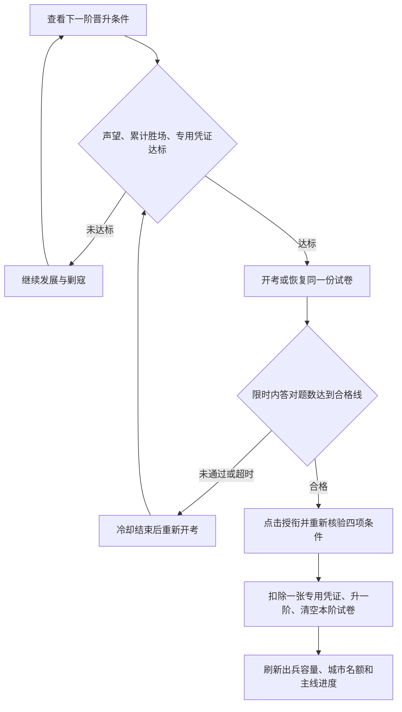

# 军衔晋升与军事笔试

更新时间：2026-10-08。晋升从列兵开始逐阶进行，保留原有 17 阶军衔、声望门槛、出兵容量和城市名额。

## 设计目标与玩家流程

声望体现发展成果，累计剿寇胜场体现实战经历，专用凭证引导玩家挑战对应等级的 NPC，军事笔试检验军事常识与指挥知识。四项条件共同组成逐阶晋升资格；主线任务展示晋升里程碑，军衔系统负责资格校验和正式授衔。

玩家在“战略主线与晋升”页面查看下一阶条件，完成剿寇与凭证收集，前三项达标后参加笔试。合格后主动点击“授衔晋升”，获得新军衔对应的出兵容量和城市名额；通过笔试本身不会提升军衔或开放名额。任务阶段锁定不限制玩家提前积累声望、胜场和凭证。

## 晋升门槛

每阶同时满足声望、累计剿寇胜场、目标军衔专用晋升凭证 ×1 和本阶军事笔试。凭证 key 为 `rank_certificate_<目标阶数>`，不同阶数不能替代。声望和胜场不扣除；只有实际晋升时扣除一张凭证。

资格判定为：`当前声望 >= 目标声望 && 累计胜场 >= 目标胜场 && 专用凭证库存 >= 1 && 本阶笔试已合格`。每次只晋升一阶，持有高级凭证也不能跳阶。胜场按账号共享，切换城市不改变计数；表中的数量均为账号累计目标，不是每次晋升后重新累计的数量。

| 目标阶数 | 军衔 | 声望 | 累计剿寇胜场 | 凭证来源 NPC 等级 | 每场胜利掉率 | 笔试合格题数 |
| --- | --- | ---: | ---: | --- | ---: | --- |
| 2 | 上等兵 | 200 | 3 | 1 | 30% | 4/5 |
| 3 | 下士 | 500 | 8 | 2 | 28% | 4/5 |
| 4 | 中士 | 1,000 | 15 | 3 | 26% | 4/5 |
| 5 | 上士 | 2,000 | 25 | 4 | 24% | 4/5 |
| 6 | 军士长 | 3,500 | 40 | 5 | 22% | 4/5 |
| 7 | 准尉 | 5,500 | 60 | 6—7 | 20% | 4/5 |
| 8 | 少尉 | 8,000 | 90 | 8—9 | 18% | 7/8 |
| 9 | 中尉 | 15,000 | 130 | 10—11 | 16% | 7/8 |
| 10 | 上尉 | 25,000 | 180 | 12—13 | 14% | 7/8 |
| 11 | 少校 | 45,000 | 250 | 14—15 | 12% | 7/8 |
| 12 | 中校 | 80,000 | 350 | 16—17 | 10% | 7/8 |
| 13 | 上校 | 150,000 | 480 | 18—20 | 9% | 7/8 |
| 14 | 大校 | 300,000 | 650 | 21—23 | 8% | 7/8 |
| 15 | 少将 | 600,000 | 850 | 24—26 | 6% | 8/10 |
| 16 | 中将 | 1,200,000 | 1,100 | 27—29 | 4% | 8/10 |
| 17 | 上将 | 2,500,000 | 1,400 | 30 | 2% | 8/10 |

剿寇按账号累计，每次进攻击败有守军的流寇或 NPC 要塞计一场，陆地与海上均有效。自动战斗与战术指挥复用结算入口；侦察、失败、空守军、野地、真实/模拟玩家城池均不计数，也不掉凭证。每场有效胜利独立抽一次，成功直接入仓库一张对应档位凭证，并写入战报。高级 NPC 不混入低阶凭证；玩家可提前收集未来军衔的凭证。

### 战功与掉落判定

“刷寇数量”在本系统中采用**有效进攻胜场**：一场战斗无论歼敌多少，都只增加一场；同一据点恢复守军后再次被击败，按新的有效战斗计数。所有允许计数的 NPC 等级均可贡献累计胜场，目标等级只决定凭证档位，因此低级 NPC 可以补足胜场，但不能产出高级凭证。

| 战斗结果 | 累计胜场 | 凭证抽取 |
| --- | --- | --- |
| 击败战前存在存活守军的流寇或 NPC 要塞，包括海上目标 | +1 | 按 NPC 等级独立抽一次 |
| 自动结算或战术指挥完成同一场有效战斗 | 同一场只计一次 | 同一场只抽一次 |
| 战败、侦察、击败空守军 | 不增加 | 不抽取 |
| 野地或真实/模拟玩家城池战斗 | 不增加 | 不抽取 |

凭证不进入珠宝宝箱、主线阶段礼包或商城产物列表；当前也没有合成、跨阶替代、兑换或掉落保底。已得到但尚未使用的凭证留在账号仓库。战报显示“剿寇胜场 +1，累计 X 场”；掉落成功时额外显示凭证名称与数量，入库不依赖运输返城。

掉率是每场有效胜利的独立概率，不承诺固定场数必掉。获得一张的理论期望场数为 `1 / p`：30% 档约 3.3 场，2% 档约 50 场；2% 档连续打 50 场至少掉一张的概率为 `1 - (1 - 0.02)^50 ≈ 63.6%`。累计胜场门槛与凭证收集是并行条件，满足胜场数量后仍可能需要继续挑战对应等级 NPC。

## 军事笔试

前三项达标后才能开考。题库包含军事常识、军史、战术协同、后勤与战略判断，共 45 道单选题，分为基础、战术、战略三个难度组，各 15 题。按目标军衔抽取 5、8 或 10 题，随机题序与选项顺序，合格线为向上取整的 80%。

### 难度与评分

| 目标军衔 | 难度组 | 题库规模 / 每卷题数 | 合格线 | 重点内容 |
| --- | --- | --- | --- | --- |
| 第 2—7 阶，上等兵至准尉 | 基础 | 15 / 5 | 至少答对 4 题 | 兵法常识、地形、侦察、通信、军纪与后勤基础 |
| 第 8—14 阶，少尉至大校 | 战术 | 15 / 8 | 至少答对 7 题 | 军史、步坦协同、火力压制、纵深防御、登陆和补给 |
| 第 15—17 阶，少将至上将 | 战略 | 15 / 10 | 至少答对 8 题 | 战略目标、联合作战、风险判断、保障能力与方案推演 |

每题四个选项且只有一个正确答案，答对计一题，无部分得分或错题扣分。合格题数按 `ceil(题数 × 0.8)` 计算，所以八题卷需要七题正确。试卷只从对应难度组内不重复抽题，不要求固定主题配额；重考可能遇到以前的题目，但会重新随机题序和选项顺序。

题库定义见 [RankExamDef.java](../backend/src/main/java/com/wargame/model/constants/RankExamDef.java)。新题应有唯一、无歧义的正确答案，选项不得重复，题库数量不得少于该难度组的每卷题数。正在进行的考试使用已保存的题目和选项快照，题库更新只影响后续新开的考试。

考试限时 15 分钟；失败后从交卷时间起冷却 10 分钟，超时后从原截止时间起冷却 10 分钟。开考、失败和重考均不扣凭证。合格资格保留至本阶正式晋升，下一阶必须重新考试。

服务端保存账号专属的试卷快照、正确答案、尝试 ID、目标阶数、截止时间和成绩。刷新、返回任务、重新登录或服务重启后可恢复同一份有效试卷，不能重新抽题或延长时间。浏览器仅按账号与尝试 ID 保存已选选项；判分以服务端为准，重复提交、伪造尝试 ID 和使用旧阶试卷均会被拒绝。

### 考试状态与时间边界

| 状态 | 含义 | 后续操作 |
| --- | --- | --- |
| `not_started` | 当前目标军衔没有有效考试记录 | 前三项达标后开考 |
| `active` | 已开考且服务器时间尚未达到截止时间 | 恢复同一试卷或完成答题后交卷 |
| `failed` | 在限时内交卷，正确题数未达标 | 从交卷处理时间起冷却 10 分钟，再核验前三项并开新卷 |
| `expired` | 未交卷的考试达到截止时间，或超时交卷已判为未通过 | 按原截止时间加 10 分钟计算可重考时间；结束旧考试或冷却后开新卷 |
| `passed` | 本阶笔试已合格 | 保留资格，前三项仍达标时可正式授衔 |

时间边界以服务器处理交卷时的时间为准，`now >= expiresAt` 即超时，超时卷按 0 题正确处理，不能用本地倒计时或已选答案补救。返回任务、切换页面、退出登录和断网不会暂停计时。超时状态可由服务器查询按截止时间计算，无须依赖客户端提交来启动冷却；即使离线超过“截止时间 + 10 分钟”，重新进入也可直接申请新卷。

例如北京时间 20:00 开考，截止时间为 20:15；若 20:06 交卷未合格，可在 20:16 重考；若超时，最早 20:25 重考，20:30 才上线也不会再追加冷却。合格资格没有额外过期时间，但正式授衔时仍核验当前声望、胜场和凭证库存；前三项不足时保留合格资格，补足即可授衔。正在答题期间前三项发生变化不影响交卷判分，恢复试卷和授衔仍执行各自的资格校验。

### 答题界面与异常处理

晋升区显示当前军衔、下一阶军衔、基础出兵容量、城市名额，以及声望、胜场、凭证的“当前值 / 目标值”和凭证来源。笔试显示题数、合格线、状态；前三项未达标时“参加军事笔试”不可用。进行中的有效试卷显示“继续军事笔试”，冷却中显示下次考试时间和“刷新资格”，合格且前三项达标时显示“授衔晋升”。

答题页显示目标军衔、倒计时、单选题、已答数量、“返回任务”和“交卷”。限时内未答完所有题目不能交卷；交卷过程中锁定选项和提交按钮，避免重复请求或画面与已提交答案不一致；超时后锁定选项，将交卷按钮改为“结束考试”，允许结束未答完的试卷。成绩区显示正确题数、总题数、合格与否及重考提示，不公布标准答案或逐题对错。

| 场景 | 处理方式 |
| --- | --- |
| 刷新、返回任务或重登，仍在有效期内 | 服务端恢复相同尝试 ID、题序、选项顺序和截止时间；同一浏览器恢复已选答案 |
| 换设备、清除浏览器存储 | 仍恢复服务端同一份试卷；已选答案仅保存在原浏览器，需重新选择 |
| 本地答题记录损坏、答案越界 | 将无效选项视为未答，不能用损坏记录满足“全部已答” |
| 交卷请求明确失败且服务端未收卷 | 保留选项，可在有效期内重试 |
| 服务端已收卷，但成功响应因断网丢失 | 重新读取资格与成绩；再次提交同一份试卷会被拒绝，不能重复判分 |
| 切换账号或旧请求迟到 | 本地答题记录按账号与尝试 ID 隔离，旧账号或旧资格响应不能覆盖当前账号状态 |
| 多个页面同时开考或交卷 | 服务端串行处理同一账号的考试操作，复用有效试卷且只接受一次交卷 |

## 主线与接口

晋升区在主线任务页显示四项条件、凭证来源、答题与成绩。军衔主线 `q1_9`、`q2_8`、`q3_7`、`q5_6`、`q6_6`、`q7_6`、`q8_7` 在实际授衔后推进；`q4_8` 要求拥有四城，其上尉晋升说明同步四项门槛。通过笔试本身不完成授衔任务。

### 主线里程碑对应关系

| 阶段 | 任务 ID / 名称 | 里程碑 | 实际判定指标 |
| --- | --- | --- | --- |
| 1 | `q1_9` 受衔晋升 | 上等兵，第 2 阶 | 已获军衔阶数 |
| 2 | `q2_8` 晋升中士 | 中士，第 4 阶 | 已获军衔阶数 |
| 3 | `q3_7` 晋升准尉 | 准尉，第 7 阶 | 已获军衔阶数 |
| 4 | `q4_8` 四海扬名 | 上尉开放四城名额后，实际拥有 4 座城池 | 城池数 `CITY_COUNT` |
| 5 | `q5_6` 名镇一方 | 少校，第 11 阶 | 已获军衔阶数 |
| 6 | `q6_6` 拜领少将 | 少将，第 15 阶 | 已获军衔阶数 |
| 7 | `q7_6` 中将督军 | 中将，第 16 阶 | 已获军衔阶数 |
| 8 | `q8_7` 终极荣耀 | 上将，第 17 阶 | 已获军衔阶数 |

七个军衔任务继续采用 `MILITARY_RANK_TIER`，正式授衔成功后触发任务事件，读取任务时也按当前军衔校准进度。既有前置任务、阶段解锁与奖励领取规则继续生效；高军衔老账号不需要为已取得的军衔补考。`q4_8` 不增加独立的笔试判定，授衔后只有名额还不够，实际城池数达到四座才满足它的状态指标。任务文案从军衔定义与笔试定义生成，展示该目标阶的条件；晋升过程仍须逐阶完成，不能直接跳到主线要求的军衔。

### 接口契约

| 方法 | 路径 | 行为 |
| --- | --- | --- |
| GET | `/api/game/rank/info` | 服务端晋升资格、考试状态、冷却、服务器时间；不返回题目或答案 |
| POST | `/api/game/rank/exam/start` | 开考或恢复，返回尝试 ID、问题、选项、截止时间与合格线；不返回正确答案 |
| POST | `/api/game/rank/exam/submit` | `{attemptId, answers}`，按选项索引提交，返回服务端成绩与最新资格 |
| POST | `/api/game/rank/promote` | 账号行锁内重新检查四项条件，同一事务扣凭证、晋升、清空本阶试卷并推进主线 |

交卷的 `answers` 数组按服务端返回的题目顺序排列，每个值是该题返回选项中的 0—3 索引；已随机化的选项位置不能用题库原始顺序代替。有效期内提交必须包含所有题目，空值、缺题、越界值、错误尝试 ID 或旧阶试卷均拒绝；超时试卷可不完整提交，但结果只能是未通过。

`rank/info` 返回服务器时间、目标军衔、前三项门槛、考试状态、正确题数与冷却时间，并给出 `canTakeExam`、`canPromote`。`exam/start` 返回问题与选项但不返回答案；`exam/submit` 返回本次成绩与最新 `rankInfo`；`rank/promote` 返回授衔结果及最新游戏状态。各接口从登录身份获取玩家 ID，不接受客户端指定考生或目标军衔。

### 数据与一致性

| 数据 | 位置 | 用途 |
| --- | --- | --- |
| 军衔、声望、累计胜场 | `players.military_rank`、`prestige`、`npc_victories` | 账号共享资格与实际军衔 |
| 专用凭证库存 | `player_items`，key 为 `rank_certificate_<tier>` | 按精确档位收集与消费 |
| 当前阶试卷与成绩 | `players.rank_exam` | JSON 保存尝试 ID、目标阶、截止时间、状态、重考时间、正确题数、题目和标准答案快照 |
| 浏览器已选答案 | `localStorage`，key 为 `rank-exam:<playerId>:<attemptId>` | 恢复选择，不作为成绩或授衔依据 |

每个账号只保存当前一次考试记录，不保留历次考试档案；重考替换旧记录，晋升后清空。玩家实体的 `rankExam` 不序列化到游戏状态，完整试卷与正确答案仅留在服务端；客户端传来的成绩、合格标记和库存数量均不能作为授衔依据。

开考、交卷和授衔均在账号行锁内执行。授衔先校验四项条件，再通过带库存条件的更新扣除一张精确凭证，与军衔更新、试卷清空和主线进度推进处于同一事务；数据库操作失败时回滚，不会出现凭证已扣但军衔未升的部分完成状态。并发的第二次授衔会按更新后的军衔核验下一阶，不能复用上阶考试资格。跨页刷新时客户端重新读取服务端资格，避免旧资格请求覆盖刚完成的交卷结果。

## 存档兼容与验证

Flyway V80 添加 `players.npc_victories`，旧账号默认 0；V81 添加 `players.rank_exam`，默认空。历史军衔和声望保留，不补算没有可靠战斗明细的旧战功。珠宝、宝箱及原有野地采集产出保留，珠宝不再用于晋升。

旧账号下一次晋升按新的累计胜场门槛进行校验，已获高阶军衔不降级。凭证使用原有道具库存表，无需另建凭证表；原珠宝宝箱继续产出原有珠宝，不转换为凭证。新增字段与后端逻辑需要通过启动新版后端加载 Flyway V80/V81 后生效；仅刷新前端不会让旧后端具备新接口。

### 验收要点

| 类别 | 应满足的结果 |
| --- | --- |
| 四项条件 | 任一项不足均不能授衔；错误档位凭证不可替代；最高军衔无下一阶考试 |
| 扣除与奖励 | 开考、交卷、失败、重考不扣凭证；成功授衔只扣一张目标凭证，声望、胜场与珠宝不扣除 |
| 战斗结算 | 有守军的流寇/NPC 要塞进攻胜利计一次；自动与战术结算不重复，其他目标和无效结果不计数 |
| 抽题与评分 | 每卷题目不重复；基础、战术、战略分别按 4/5、7/8、8/10 合格；答案不能出现在客户端响应 |
| 时间与恢复 | 截止时间不可延长，超时不可通过；恢复不换卷；冷却基准区分交卷失败与超时 |
| 并发与异常 | 重复提交与旧阶尝试拒绝，授衔重新核验库存，账号切换和迟到响应不串号 |
| 主线联动 | 笔试通过不完成授衔任务，正式授衔推进军衔指标；四海扬名仍需实际四城 |
| 界面 | 题目和选项在窄屏换行；未答完禁交卷，交卷中与超时锁选项，返回后可恢复有效试卷 |

`RankPromotionTest` 覆盖四项门槛、精确凭证扣除、主线联动、复用试卷、答案隔离、失败冷却、超时、无效与重复提交、跨阶失效及掉率边界。`MarchServiceTest` 验证自动/战术结算只累计一次；前端 `rank-exam.test.cjs` 验证资格展示、选项恢复、交卷、时钟与账号隔离。

2026-10-08 验证记录：后端 `RankPromotionTest` 11 项、`QuestStageSystemTest` 3 项及前端考试专项 8 项通过。使用真实前端脚本与样式、模拟 API 的浏览器检查在 1440×900、390×844、320×740 下通过，覆盖资格展示、未答完禁交卷、返回恢复、交卷成绩、授衔入口、横向溢出和页面异常；该检查不代表新版后端与真实玩家数据已完成联调。扩展后端检查 69 项中有一项既有野地采集载重期望失败，全量前端 562 项中有四项既有首页模块顺序失败，未将这些检查记录为全量通过。

相关说明：[总设计](DESIGN.md)、[主线任务设计](../QUEST_SYSTEM.md)。
