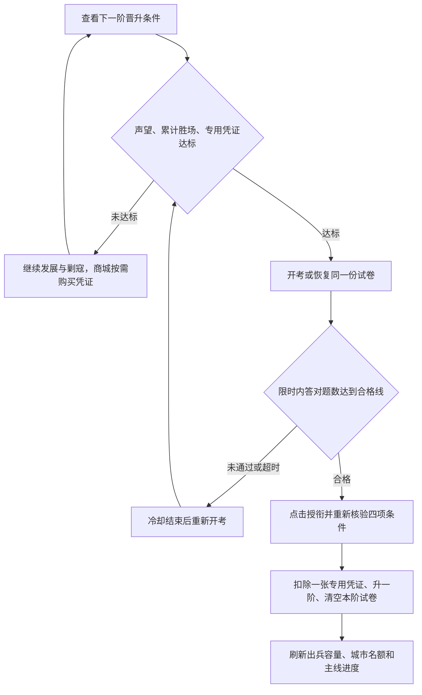

# 军衔晋升与军事笔试

更新时间：2026-10-28。晋升从列兵开始逐阶进行，共 17 阶；上等兵、下士、中士、上士、军士长分别为 1、10、30、50、100 万声望；准尉起为 150 万，上将封顶 1,000 万。列兵初始门槛为 0。

## 设计目标与玩家流程

声望体现发展成果，累计剿寇胜场体现实战经历，专用凭证由玩家在商城按需花费钻石购买，军事笔试检验军事常识与指挥知识。四项条件共同组成逐阶晋升资格；主线任务展示晋升里程碑，军衔系统负责资格校验和正式授衔。

玩家在“战略主线与晋升”页面查看下一阶条件，完成剿寇并从该页进入商城购买对应军衔凭证，前三项达标后参加笔试。合格后主动点击“授衔晋升”，获得新军衔对应的出兵容量和城市名额；购买凭证和通过笔试本身都不会提升军衔或开放名额。任务阶段锁定不限制玩家提前积累声望、胜场或购买未来军衔凭证。

## 晋升门槛

声望分段推进：士兵与士官为 1 万—100 万，准尉及尉官为 150 万—330 万，校官为 410 万—700 万，将官为 800 万—1,000 万。准尉起相邻门槛差从 50 万逐步增加到 100 万，将官每阶增加 100 万；这些是当前声望门槛，不是额外支付的费用。

累计剿寇胜场阶梯：上等兵 10 场、下士 50 场、中士 110 场、上士 200 场、军士长 300 场；准尉 450 场、少尉 650 场、中尉 900 场、上尉 1,200 场；校官依次为 1,600、2,100、2,700、3,400 场；将官依次为 4,200、5,100、6,100 场。准尉起相邻门槛差由 150 场逐步增至 1,000 场，按账号累计，不因晋升清零或扣除。

每阶同时满足声望、累计剿寇胜场、目标军衔专用晋升凭证 ×1 和本阶军事笔试。凭证 key 为 `rank_certificate_<目标阶数>`，不同阶数不能替代。声望和胜场不扣除；只有实际晋升时扣除一张凭证。

资格判定为：`当前声望 >= 目标声望 && 累计胜场 >= 目标胜场 && 专用凭证库存 >= 1 && 本阶笔试已合格`。每次只晋升一阶，持有高级凭证也不能跳阶。胜场按账号共享，切换城市不改变计数；表中的数量均为账号累计目标，不是每次晋升后重新累计的数量。

| 目标阶数 | 军衔 | 声望 | 累计剿寇胜场 | 凭证售价（钻石/张） | 笔试合格题数 |
| --- | --- | ---: | ---: | ---: | --- |
| 2 | 上等兵 | 10,000 | 10 | 20 | 4/5 |
| 3 | 下士 | 100,000 | 50 | 40 | 4/5 |
| 4 | 中士 | 300,000 | 110 | 60 | 4/5 |
| 5 | 上士 | 500,000 | 200 | 80 | 4/5 |
| 6 | 军士长 | 1,000,000 | 300 | 100 | 4/5 |
| 7 | 准尉 | 1,500,000 | 450 | 150 | 4/5 |
| 8 | 少尉 | 2,000,000 | 650 | 200 | 7/8 |
| 9 | 中尉 | 2,600,000 | 900 | 300 | 7/8 |
| 10 | 上尉 | 3,300,000 | 1,200 | 400 | 7/8 |
| 11 | 少校 | 4,100,000 | 1,600 | 600 | 7/8 |
| 12 | 中校 | 5,000,000 | 2,100 | 800 | 7/8 |
| 13 | 上校 | 6,000,000 | 2,700 | 1,000 | 7/8 |
| 14 | 大校 | 7,000,000 | 3,400 | 1,200 | 7/8 |
| 15 | 少将 | 8,000,000 | 4,200 | 1,500 | 8/10 |
| 16 | 中将 | 9,000,000 | 5,100 | 2,000 | 8/10 |
| 17 | 上将 | 10,000,000 | 6,100 | 2,500 | 8/10 |

剿寇按账号累计，每次进攻击败有守军的流寇或 NPC 要塞计一场，陆地与海上均有效。自动战斗与战术指挥复用结算入口；侦察、失败、空守军、野地、真实/模拟玩家城池均不计数。所有 NPC 等级均不再掉落晋升凭证，战斗只累计有效剿寇胜场。

### 战功与凭证购买

“刷寇数量”在本系统中采用**有效进攻胜场**：一场战斗无论歼敌多少，都只增加一场；同一据点恢复守军后再次被击败，按新的有效战斗计数。所有允许计数的 NPC 等级均可贡献累计胜场，凭证不再与 NPC 等级、随机掉落或返城结算关联。

| 战斗结果 | 累计胜场 | 凭证产出 |
| --- | --- | --- |
| 击败战前存在存活守军的流寇或 NPC 要塞，包括海上目标 | +1 | 不产出 |
| 自动结算或战术指挥完成同一场有效战斗 | 同一场只计一次 | 不产出 |
| 战败、侦察、击败空守军 | 不增加 | 不产出 |
| 野地或真实/模拟玩家城池战斗 | 不增加 | 不产出 |

商城增加“晋升凭证”分类，按目标军衔展示全部 16 档商品。每次只能购买一张，每档最多购买至持有一张未使用凭证；已获得军衔的档位不可再购，持有任何正数库存时也不可重复购买。允许提前购买未来军衔凭证，但不能跳阶或替代其他档位。新规则防止继续刷取或重复购买造成堆积；旧库存原样保留，授衔仍只消耗一张。凭证不进入宝箱或主线阶段礼包，也不支持合成、跨阶替代或兑换。

售价以服务端军衔定义为准，不接受客户端传入价格。购买在账号锁内核验最新军衔、库存和钻石，同一事务完成扣钻与入仓，失败回滚。库存及钻石使用锁定读取，避免 MySQL 可重复读快照漏掉等待期间已提交的变更。凭证库存与钻石均按账号共享，切换城市不能绕过限制。战报仅显示“剿寇胜场 +1，累计 X 场”，不再显示凭证掉落奖励。

## 军事笔试

前三项达标后才能开考。题库包含军事常识、军史、战术协同、后勤与战略判断，共 45 道单选题，分为基础、战术、战略三个难度组，各 15 题。按目标军衔抽取 5、8 或 10 题，随机题序与选项顺序，合格线为向上取整的 80%。

### 难度与评分

| 目标军衔 | 难度组 | 题库规模 / 每卷题数 | 合格线 | 重点内容 |
| --- | --- | --- | --- | --- |
| 第 2—7 阶，上等兵至准尉 | 基础 | 15 / 5 | 至少答对 4 题 | 兵法常识、地形、侦察、通信、军纪与后勤基础 |
| 第 8—14 阶，少尉至大校 | 战术 | 15 / 8 | 至少答对 7 题 | 军史、步坦协同、火力压制、纵深防御、登陆和补给 |
| 第 15—17 阶，少将至上将 | 战略 | 15 / 10 | 至少答对 8 题 | 战略目标、联合作战、风险判断、保障能力与方案推演 |

每题四个选项且只有一个正确答案，答对计一题，无部分得分或错题扣分。合格题数按 `ceil(题数 × 0.8)` 计算，所以八题卷需要七题正确。试卷只从对应难度组内不重复抽题，不要求固定主题配额；重考可能遇到以前的题目，但会重新随机题序和选项顺序。

题库定义见 [RankExamDef.java](../backend/src/main/java/com/wargame/model/constants/RankExamDef.java)。新题应有唯一、无歧义的正确答案，选项不得重复，题库数量不得少于该难度组的每卷题数。正在进行的考试使用已保存的题目和选项快照，题库更新只影响后续新开的考试。

考试限时 15 分钟；失败后从交卷时间起冷却 10 分钟，超时后从原截止时间起冷却 10 分钟。开考、失败和重考均不扣凭证。合格资格保留至本阶正式晋升，下一阶必须重新考试。

服务端保存账号专属的试卷快照、正确答案、尝试 ID、目标阶数、截止时间和成绩。刷新、返回任务、重新登录或服务重启后可恢复同一份有效试卷，不能重新抽题或延长时间。浏览器仅按账号与尝试 ID 保存已选选项；判分以服务端为准，重复提交、伪造尝试 ID 和使用旧阶试卷均会被拒绝。

### 考试状态与时间边界

| 状态 | 含义 | 后续操作 |
| --- | --- | --- |
| `not_started` | 当前目标军衔没有有效考试记录 | 前三项达标后开考 |
| `active` | 已开考且服务器时间尚未达到截止时间 | 恢复同一试卷或完成答题后交卷 |
| `failed` | 在限时内交卷，正确题数未达标 | 从交卷处理时间起冷却 10 分钟，再核验前三项并开新卷 |
| `expired` | 未交卷的考试达到截止时间，或超时交卷已判为未通过 | 按原截止时间加 10 分钟计算可重考时间；结束旧考试或冷却后开新卷 |
| `passed` | 本阶笔试已合格 | 保留资格，前三项仍达标时可正式授衔 |

时间边界以服务器处理交卷时的时间为准，`now >= expiresAt` 即超时，超时卷按 0 题正确处理，不能用本地倒计时或已选答案补救。返回任务、切换页面、退出登录和断网不会暂停计时。超时状态可由服务器查询按截止时间计算，无须依赖客户端提交来启动冷却；即使离线超过“截止时间 + 10 分钟”，重新进入也可直接申请新卷。

例如北京时间 20:00 开考，截止时间为 20:15；若 20:06 交卷未合格，可在 20:16 重考；若超时，最早 20:25 重考，20:30 才上线也不会再追加冷却。合格资格没有额外过期时间，但正式授衔时仍核验当前声望、胜场和凭证库存；前三项不足时保留合格资格，补足即可授衔。正在答题期间前三项发生变化不影响交卷判分，恢复试卷和授衔仍执行各自的资格校验。

### 答题界面与异常处理

晋升区显示当前军衔、下一阶军衔、基础出兵容量、城市名额，以及声望、胜场、凭证的“当前值 / 目标值”和商城售价。缺少凭证时提供“前往商城购买”入口，清除旧筛选并定位对应商品；商城已持有或已授衔档位显示禁购原因。笔试显示题数、合格线、状态；前三项未达标时“参加军事笔试”不可用。进行中的有效试卷显示“继续军事笔试”，冷却中显示下次考试时间和“刷新资格”，合格且前三项达标时显示“授衔晋升”。

答题页显示目标军衔、倒计时、单选题、已答数量、“返回任务”和“交卷”。限时内未答完所有题目不能交卷；交卷过程中锁定选项和提交按钮，避免重复请求或画面与已提交答案不一致；超时后锁定选项，将交卷按钮改为“结束考试”，允许结束未答完的试卷。成绩区显示正确题数、总题数、合格与否及重考提示，不公布标准答案或逐题对错。

| 场景 | 处理方式 |
| --- | --- |
| 刷新、返回任务或重登，仍在有效期内 | 服务端恢复相同尝试 ID、题序、选项顺序和截止时间；同一浏览器恢复已选答案 |
| 换设备、清除浏览器存储 | 仍恢复服务端同一份试卷；已选答案仅保存在原浏览器，需重新选择 |
| 本地答题记录损坏、答案越界 | 将无效选项视为未答，不能用损坏记录满足“全部已答” |
| 交卷请求明确失败且服务端未收卷 | 保留选项，可在有效期内重试 |
| 服务端已收卷，但成功响应因断网丢失 | 重新读取资格与成绩；再次提交同一份试卷会被拒绝，不能重复判分 |
| 切换账号或旧请求迟到 | 本地答题记录按账号与尝试 ID 隔离，旧账号或旧资格响应不能覆盖当前账号状态 |
| 多个页面同时开考或交卷 | 服务端串行处理同一账号的考试操作，复用有效试卷且只接受一次交卷 |

## 主线与接口

晋升区在主线任务页显示四项条件、凭证来源、答题与成绩。军衔主线 `q1_9`、`q2_8`、`q3_7`、`q5_6`、`q6_6`、`q7_6`、`q8_7` 在实际授衔后推进；`q4_8` 要求拥有四城，其上尉晋升说明同步四项门槛。通过笔试本身不完成授衔任务。

### 主线里程碑对应关系

| 阶段 | 任务 ID / 名称 | 里程碑 | 实际判定指标 |
| --- | --- | --- | --- |
| 1 | `q1_9` 受衔晋升 | 上等兵，第 2 阶 | 已获军衔阶数 |
| 2 | `q2_8` 晋升中士 | 中士，第 4 阶 | 已获军衔阶数 |
| 3 | `q3_7` 晋升准尉 | 准尉，第 7 阶 | 已获军衔阶数 |
| 4 | `q4_8` 四海扬名 | 上尉开放六城名额后，任务仍要求实际拥有 4 座城池 | 城池数 `CITY_COUNT` |
| 5 | `q5_6` 名镇一方 | 少校，第 11 阶 | 已获军衔阶数 |
| 6 | `q6_6` 拜领少将 | 少将，第 15 阶 | 已获军衔阶数 |
| 7 | `q7_6` 中将督军 | 中将，第 16 阶 | 已获军衔阶数 |
| 8 | `q8_7` 终极荣耀 | 上将，第 17 阶 | 已获军衔阶数 |

七个军衔任务继续采用 `MILITARY_RANK_TIER`，正式授衔成功后触发任务事件，读取任务时也按当前军衔校准进度。既有前置任务、阶段解锁与奖励领取规则继续生效；高军衔老账号不需要为已取得的军衔补考。`q4_8` 不增加独立的笔试判定，授衔后只有名额还不够，实际城池数达到四座才满足它的状态指标。任务文案从军衔定义与笔试定义生成，展示该目标阶的条件；晋升过程仍须逐阶完成，不能直接跳到主线要求的军衔。

### 接口契约

| 方法 | 路径 | 行为 |
| --- | --- | --- |
| GET | `/api/game/rank/info` | 服务端晋升资格、考试状态、冷却、服务器时间；不返回题目或答案 |
| POST | `/api/game/rank/exam/start` | 开考或恢复，返回尝试 ID、问题、选项、截止时间与合格线；不返回正确答案 |
| POST | `/api/game/rank/exam/submit` | `{attemptId, answers}`，按选项索引提交，返回服务端成绩与最新资格 |
| POST | `/api/game/rank/promote` | 账号行锁内重新检查四项条件，同一事务扣凭证、晋升、清空本阶试卷并推进主线 |
| POST | `/api/game/shop/buy` | `{itemId: "rank_certificate_<tier>", count: 1}`，账号锁内校验档位、库存及钻石，按服务端售价扣钻并入仓 |

交卷的 `answers` 数组按服务端返回的题目顺序排列，每个值是该题返回选项中的 0—3 索引；已随机化的选项位置不能用题库原始顺序代替。有效期内提交必须包含所有题目，空值、缺题、越界值、错误尝试 ID 或旧阶试卷均拒绝；超时试卷可不完整提交，但结果只能是未通过。

`rank/info` 返回服务器时间、目标军衔、前三项门槛、考试状态、正确题数与冷却时间，并给出 `canTakeExam`、`canPromote`。`exam/start` 返回问题与选项但不返回答案；`exam/submit` 返回本次成绩与最新 `rankInfo`；`rank/promote` 返回授衔结果及最新游戏状态。各接口从登录身份获取玩家 ID，不接受客户端指定考生或目标军衔。

### 数据与一致性

| 数据 | 位置 | 用途 |
| --- | --- | --- |
| 军衔、声望、累计胜场 | `players.military_rank`、`prestige`、`npc_victories` | 账号共享资格与实际军衔 |
| 专用凭证库存 | `player_items`，key 为 `rank_certificate_<tier>` | 按精确档位购买与消费 |
| 当前阶试卷与成绩 | `players.rank_exam` | JSON 保存尝试 ID、目标阶、截止时间、状态、重考时间、正确题数、题目和标准答案快照 |
| 浏览器已选答案 | `localStorage`，key 为 `rank-exam:<playerId>:<attemptId>` | 恢复选择，不作为成绩或授衔依据 |

每个账号只保存当前一次考试记录，不保留历次考试档案；重考替换旧记录，晋升后清空。玩家实体的 `rankExam` 不序列化到游戏状态，完整试卷与正确答案仅留在服务端；客户端传来的成绩、合格标记和库存数量均不能作为授衔依据。

开考、交卷和授衔均在账号行锁内执行。授衔先校验四项条件，再通过带库存条件的更新扣除一张精确凭证，与军衔更新、试卷清空和主线进度推进处于同一事务；数据库操作失败时回滚，不会出现凭证已扣但军衔未升的部分完成状态。并发的第二次授衔会按更新后的军衔核验下一阶，不能复用上阶考试资格。跨页刷新时客户端重新读取服务端资格，避免旧资格请求覆盖刚完成的交卷结果。

## 存档兼容与验证

Flyway V80 添加 `players.npc_victories`，旧账号默认 0；V81 添加 `players.rank_exam`，默认空。历史军衔和声望保留，不补算没有可靠战斗明细的旧战功。晋升凭证归入仓库的功能道具分类。

本次声望与累计剿寇胜场阶梯调整不重算历史军衔、不扣减或补发声望及胜场，不需要新增数据库迁移。旧账号保留已获军衔及对应容量、城市名额；下一次晋升按新声望、新累计胜场门槛和既有的专用凭证、笔试资格校验。已通过的本阶笔试继续保留，但正式授衔时仍须达到新声望和新累计胜场门槛。凭证使用原有道具库存表，无需另建凭证表。新增字段与后端逻辑需要通过启动新版后端加载 Flyway V80/V81 后生效；仅刷新前端不会让旧后端具备新接口。

2026-10-28 凭证商城改版复用原有道具 key 和库存表，无需新增数据库迁移。旧凭证库存、军衔、声望、累计胜场及已合格笔试原样保留，不自动清除、折算或补发；正数旧库存继续用于对应阶授衔，并阻止重复购买。部署新版后端并刷新新版前端后生效。

Flyway V98 清理全部九种珠宝和六种珠宝宝箱的旧库存（含零库存行），不转换为其他奖励；保留晋升凭证、阶段礼包及其他道具。珠宝定义、采集掉落、开箱、商城商品和礼包赠品已移除，采集返程事件不再包含 `gems` 字段。部署新版后端并执行迁移后生效。

### 验收要点

| 类别 | 应满足的结果 |
| --- | --- |
| 四项条件 | 任一项不足均不能授衔；错误档位凭证不可替代；最高军衔无下一阶考试 |
| 扣除与奖励 | 开考、交卷、失败、重考不扣凭证；成功授衔只扣一张目标凭证，声望与胜场不扣除 |
| 战斗结算 | 有守军的流寇/NPC 要塞进攻胜利计一次；自动与战术结算不重复，其他目标和无效结果不计数 |
| 商城购买 | 16 档售价一致；只扣账号钻石、入仓一张；缺钻、重复、批量、已授衔档位及伪造 key 拒绝且不扣钻 |
| 凭证并发与兼容 | 两次并发购买仅一次成功，库存空行和零库存行均适用；失败回滚扣钻与入仓，旧库存原样保留 |
| 抽题与评分 | 每卷题目不重复；基础、战术、战略分别按 4/5、7/8、8/10 合格；答案不能出现在客户端响应 |
| 时间与恢复 | 截止时间不可延长，超时不可通过；恢复不换卷；冷却基准区分交卷失败与超时 |
| 并发与异常 | 重复提交与旧阶尝试拒绝，授衔重新核验库存，账号切换和迟到响应不串号 |
| 主线联动 | 笔试通过不完成授衔任务，正式授衔推进军衔指标；四海扬名仍需实际四城 |
| 界面 | 题目和选项在窄屏换行；未答完禁交卷，交卷中与超时锁选项，返回后可恢复有效试卷 |

`ShopControllerTest` 验证全部 16 档购买、笔试和授衔闭环及拒绝场景；`RankCertificatePurchaseConcurrencyTest` 验证并发限购与事务回滚。`RankPromotionTest` 覆盖四项门槛、精确凭证扣除、主线联动、复用试卷、答案隔离、失败冷却、超时、无效与重复提交、跨阶失效，以及 NPC 1—30 级均不掉凭证。`MarchServiceTest` 验证自动/战术结算只累计一次；前端 `rank-exam.test.cjs` 验证资格展示、选项恢复、交卷、时钟与账号隔离。

2026-10-08 验证记录：后端 `RankPromotionTest` 11 项、`QuestStageSystemTest` 3 项及前端考试专项 8 项通过。使用真实前端脚本与样式、模拟 API 的浏览器检查在 1440×900、390×844、320×740 下通过，覆盖资格展示、未答完禁交卷、返回恢复、交卷成绩、授衔入口、横向溢出和页面异常；该检查不代表新版后端与真实玩家数据已完成联调。扩展后端检查 69 项中有一项既有野地采集载重期望失败，全量前端 562 项中有四项既有首页模块顺序失败，未将这些检查记录为全量通过。

2026-10-28 声望阶梯验证：后端 `RankPromotionTest` 28 项、`QuestStageSystemTest` 3 项通过；前端 `rank-prestige.test.cjs`、`rank-exam.test.cjs`、`player-profile.test.cjs` 合计 27 项通过。覆盖全部 16 次晋升在门槛减一与恰好达标时的资格、未通过笔试拒绝授衔、晋升不扣声望与胜场、精确凭证扣除、前后端及文档门槛一致、旧账号军衔与已合格笔试保留，以及最高军衔无下一阶。本次记录为专项验证，不代表已部署运行服务或全量回归通过。

2026-10-28 累计剿寇胜场阶梯验证：后端 `RankPromotionTest` 44 项、`QuestStageSystemTest` 3 项通过；前端 `rank-prestige.test.cjs`、`rank-exam.test.cjs`、`player-profile.test.cjs` 合计 28 项通过。覆盖全部 16 次晋升的胜场不足、恰好达标、超额累计，笔试合格后授衔仍重新核验胜场，晋升不扣胜场，旧军衔、旧累计胜场和已合格笔试保留，前后端及晋升文档数值一致，以及主线任务说明和界面临界值展示。本次为专项验证，尚未部署或重启运行服务，不代表全量回归通过。

2026-10-28 晋升凭证商城改版验证：后端 `ShopControllerTest`、`RankPromotionTest`、`QuestStageSystemTest`、`RankCertificatePurchaseConcurrencyTest` 和 `NewbiePackConcurrencyTest` 合计 130 项通过；前端商城、凭证图标、笔试、声望和资料专项合计 50 项通过。覆盖 16 档服务端售价、购买后开考与正式授衔、重复/批量/已授衔档位拒绝、缺钻不扣费、双请求并发只扣费一次、入仓失败回滚、旧库存保留，以及全等级 NPC 不再掉落凭证。本次后端验证使用 H2 测试库，尚未部署或重启运行服务，不代表 MySQL 实库联调或全量回归通过。

已实现：[军衔晋升钻石大礼包](RANK_DIAMOND_GIFTS_DESIGN_20261028.md)。每次正式授衔后向仓库发放新军衔礼包，开启后获得购买下一阶凭证所需的共享钻石；列兵启程礼包 20 钻石，上将荣耀礼包 5,000 钻石。旧账号仅按 V139 固定的上线当前军衔补发一份，每账号每阶只发一次。部署新版后端执行 V139，并加载新版前端后生效；具体规则与验证记录见礼包文档。

相关说明：[总设计](DESIGN.md)、[主线任务设计](../QUEST_SYSTEM.md)。
