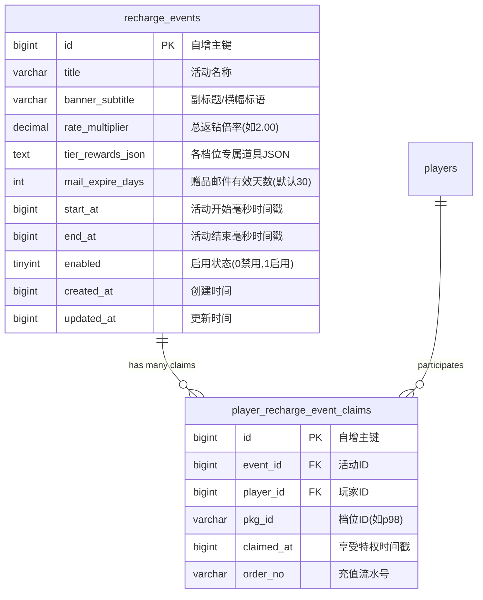
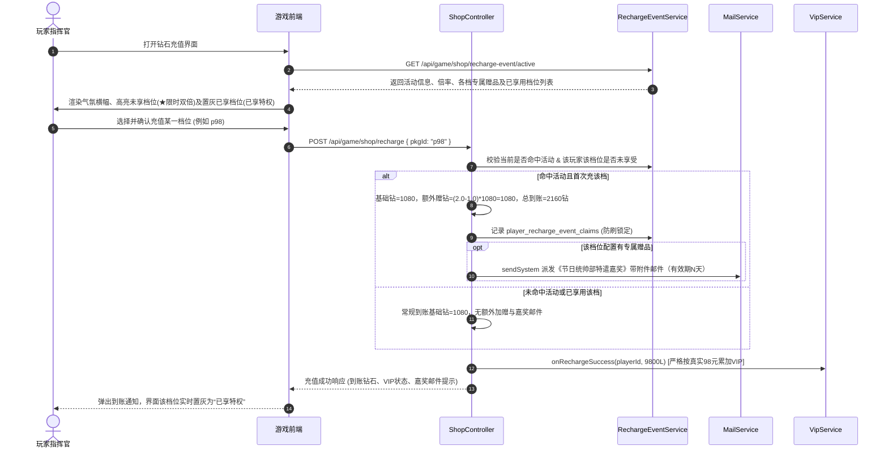

# 充值节日返利与特遣嘉奖系统设计文档

> **文档版本**：v1.0.0  
> **状态**：待评审 / 实施准备  
> **编写时间**：2026-10-29  
> **涉及系统**：后端服务 (`backend`)、游戏客户端 (`frontend`)、运营管理后台 (`Strategies-of-the-Flaming-Plains-Admin`)

---

## 1. 需求背景与业务目标

### 1.1 业务背景
在游戏节假日或特定运营节点（如国庆黄金周、元旦跨年、周年庆典等），商业化运营需要通过具有吸引力的充值返利与买赠活动来激活玩家付费意愿、提升大盘充值流水与活跃度。

### 1.2 核心目标
1. **多倍返钻激励**：在活动期间对全充值档位生效统一翻倍（如 2.0x 双倍、3.0x 三倍）；
2. **档位专属赠礼**：支持为不同档位灵活搭配商城指定高价值道具（如高档赠送高级战争动员令、72 小时防护盾等）；
3. **保护大盘经济与 VIP 体系**：赠送的钻石仅作为游戏内代币，不得稀释真实 VIP 累充金额；
4. **后台全动态配置**：运营人员在管理后台可自主完成排期、倍率设定、专属道具组合与邮件有效期调整，无需停机或发版。

---

## 2. 核心业务规则与设计定案

经过前期深度推演与业务对齐，本系统的核心规则明确如下：

| 规则项 | 业务定案 | 详细设计与约束 |
| :--- | :--- | :--- |
| **返钻倍率模型** | **全活动统一总倍率** | 活动整体配置一个全局总倍率（例如 `2.0`、`3.0`），充值界面统一强化“全档限时双倍/三倍”节日氛围。 |
| **档位专属赠礼** | **各档位独立配置赠品** | ¥6 ~ ¥10,000 的各个档位可独立勾选商城道具及数量（低档可纯返钻不送道具，高档赠送高阶道具包）。 |
| **活动排期冲突** | **方案 A（严格互斥拦截）** | 后台在创建或启用活动时，严格校验起止时间范围，同一时间段严禁重叠，从源头避免规则冲突与玩家重复套利。 |
| **礼品交付形式** | **系统邮件带附件下发** | 充值到账后，除钻石直入余额，专属赠品自动签发《🎖️ 节日统帅部特遣嘉奖》公文邮件，由玩家点击领取。 |
| **邮件时效机制** | **后台运营自定义天数** | 在后台配置活动时提供输入框（如 7 天、15 天、30 天，默认 30 天），过期后系统按规则清理，避免死号沉淀。 |
| **VIP 经验保护** | **真实人民币净额结算** | 赠送的翻倍钻石仅作为代币增加，VIP 累充战费（`totalRechargeCents`）严格按真实支付的人民币分核算。 |
| **享受频次限制** | **各档位独立限享 1 次** | 类似节日首充重置机制，活动期内每个档位独立享受 1 次特权。 |
| **已用档位表现** | **选项 A（置灰打标提示）** | 玩家享受完某档后，该卡片角标由金色 `限时双倍` 变为置灰 `已享特权`，其余未充档位保持高亮，形成对比促销。 |

---

## 3. 数据模型与持久化设计

在 MySQL 数据库中新增 2 张业务表，通过 Flyway 迁移脚本（`V138__recharge_festival_events.sql`）管理：



### 3.1 活动主表：`recharge_events`
```sql
CREATE TABLE IF NOT EXISTS recharge_events (
    id BIGINT AUTO_INCREMENT PRIMARY KEY,
    title VARCHAR(100) NOT NULL COMMENT '活动名称',
    banner_subtitle VARCHAR(255) NULL COMMENT '前台横幅导语',
    rate_multiplier DECIMAL(4, 2) NOT NULL DEFAULT 2.00 COMMENT '统一返钻倍率',
    tier_rewards_json TEXT NULL COMMENT '各档位专属道具配比JSON, 结构: {"p98":[{"key":"mobilizationOrder","count":2}]}',
    mail_expire_days INT NOT NULL DEFAULT 30 COMMENT '赠品邮件有效天数',
    start_at BIGINT NOT NULL COMMENT '开始毫秒时间戳',
    end_at BIGINT NOT NULL COMMENT '结束毫秒时间戳',
    enabled TINYINT(1) NOT NULL DEFAULT 1 COMMENT '1启用, 0禁用',
    created_at BIGINT NOT NULL,
    updated_at BIGINT NOT NULL,
    INDEX idx_event_time_window (start_at, end_at, enabled)
) ENGINE=InnoDB DEFAULT CHARSET=utf8mb4;
```

### 3.2 玩家特权使用记录表：`player_recharge_event_claims`
```sql
CREATE TABLE IF NOT EXISTS player_recharge_event_claims (
    id BIGINT AUTO_INCREMENT PRIMARY KEY,
    event_id BIGINT NOT NULL COMMENT '活动ID',
    player_id BIGINT NOT NULL COMMENT '玩家ID',
    pkg_id VARCHAR(32) NOT NULL COMMENT '充值档位ID(p6,p30,p98...)',
    claimed_at BIGINT NOT NULL COMMENT '享受特权时间戳',
    order_no VARCHAR(64) NULL COMMENT '充值订单流水号',
    CONSTRAINT uk_event_player_pkg UNIQUE (event_id, player_id, pkg_id),
    INDEX idx_claim_player_event (player_id, event_id)
) ENGINE=InnoDB DEFAULT CHARSET=utf8mb4;
```

---

## 4. 后端服务端接口与核心业务链路



### 4.1 管理端 RESTful 接口
- `GET /api/admin/recharge-events`：分页查询活动列表与状态；
- `POST /api/admin/recharge-events`：创建活动（**严格执行方案 A 校验**：若 `[start_at, end_at]` 与现有任一已启用活动有重叠，抛出业务异常 `EVENT_TIME_CONFLICT: 同一时间段已存在有效活动`）；
- `PUT /api/admin/recharge-events/{id}`：编辑活动信息与各档位赠品；
- `PUT /api/admin/recharge-events/{id}/toggle`：快速启停开关；
- `DELETE /api/admin/recharge-events/{id}`：删除未生效的草稿活动。

### 4.2 客户端 RESTful 接口
- `GET /api/game/shop/recharge-event/active`：获取当前时刻生效的活动；
  - 返回字段：`active` (bool), `event` (活动基本属性、倍率、各档专属赠品映射), `claimedPkgIds` (当前玩家在本次活动中已享受特权的档位 ID 列表)。
- `POST /api/game/shop/recharge`：
  - 充值核心事务内部判定并记录特权，派发邮件，锁定防刷。

---

## 5. 管理后台前端界面交互设计 (`Admin`)

在管理后台新增 **「充值活动」**（`RechargeEventsView.vue`）菜单：

1. **活动概览表格**：
   - 列定义：活动 ID、活动名称、时效状态（`🟢 进行中` / `🟡 未开始` / `⚪ 已结束` / `🔴 已停用`）、起止时间、返钻倍率（如 `2.0x`）、邮件有效期、启用开关、操作列（编辑、各档赠品预览、删除）。
2. **新建/编辑活动对话框**：
   - **基础设置**：活动名称、充值页标语、起止时间范围（`ElDatePicker` 带前置冲突校验）；
   - **倍率与邮件设置**：统一返钻倍率（支持 `2.0`、`2.5`、`3.0` 等快捷选项及自定义微调）、礼品邮件有效天数输入框（默认 `30`，支持输入 `1~365`）；
   - **各档位专属道具配置矩阵（核心表单）**：
     - 清晰列出预设的 10 个标准档位（¥6, ¥30, ¥98, ¥198, ¥328, ¥648, ¥1280, ¥3000, ¥6000, ¥10000）；
     - 每个档位右侧提供「添加赠品道具」组件（基于已有的商城道具字典，如经验书、动员令、加速符、防护盾），支持自由增删与数量配置。

---

## 6. 游戏客户端充值界面交互设计 (`Client`)

1. **节日氛围横幅 (Banner)**：
   - 界面顶部呈现军务风格红色/金色战备旗帜背景，展示活动名称与活动截止倒计时。
2. **卡片视觉分态 (严格落实选项 A)**：
   - **未充值档位**：
     - 右上角高亮金色徽章：`★ 限时 2.0 倍`；
     - 原基础钻石打删除线（`1080 💎`），主文本显示活动到账 `2160 💎`；
     - 卡片底栏展示赠品标签（如 `🎁 赠: 动员令x2, 护盾x1`），鼠标悬浮可查看道具详情与说明。
   - **已享用档位**：
     - 右上角徽章变为灰暗色调：`已享特权`；
     - 恢复常规显示 `1080 💎`，卡片下方标注文字：`（本活动特权名额已用完）`；
     - 其余未充值档位依然金光闪烁，形成强烈对比，促进跨档位转化。
3. **嘉奖公文邮件**：
   - 充值成功后，若该档有专属赠品，弹窗 Toast 明确提示：*“充值成功！特遣嘉奖公文已送达您的收件箱，请注意查收。”*

---

## 7. 实施落地步骤

1. **步骤一：数据库层持久化**
   - 编写并执行迁移脚本 `backend/src/main/resources/db/migration/V138__recharge_festival_events.sql`；
   - 创建实体类 `RechargeEvent.java` 与 `PlayerRechargeEventClaim.java`。
2. **步骤二：服务端逻辑开发**
   - 创建 `RechargeEventRepository`、`PlayerRechargeEventClaimRepository`；
   - 编写 `RechargeEventService`（实现时间互斥校验、有效活动探测、赠品组装、邮件超时计算）；
   - 改造 `ShopController.recharge` 与新增管理端 `AdminRechargeEventController`。
3. **步骤三：管理后台开发**
   - 在后台前端项目增加 `src/api/rechargeEvent.js`；
   - 编写 `src/views/RechargeEventsView.vue`，集成档位道具多选配置矩阵；
   - 注册路由与侧边栏导航。
4. **步骤四：游戏前台适配与联调**
   - 改造 `frontend/js/recharge.js` 与 `frontend/css/style.css`；
   - 动态获取生效活动并实现选项 A 置灰打标与赠品浮窗；
   - 执行端到端完整闭环自动化测试。
