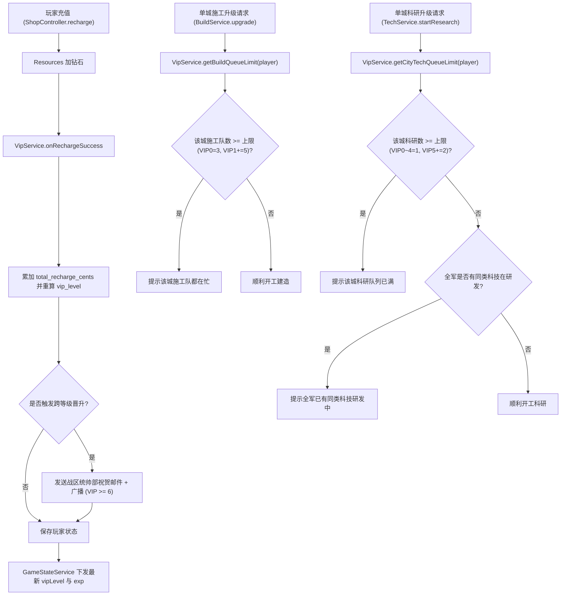

# 山河远征录 · 战时特勤统帅部（VIP 特许系统）设计规范

- 文档版本：v1.3.0 (高阶全景研讨定稿版)
- 撰写日期：2026-10-26
- 当前状态：已完成核心议题全量研讨，定稿待实施

---

## 一、 系统定位与世界观包装

### 1.1 历史背景与包装设定
本游戏立足于 1941 年中国远征军入缅作战、保卫滇缅公路国际生命线的历史背景。
为避免单纯的商业化页游“土豪/充钱变强”突兀感，VIP 系统在世界观上包装为：
**「战时最高军委会·战略后勤特勤委任（简称：特勤统帅部）」**。

玩家向后方战时军备筹措资金（充值），盟军中国战区统帅部与军事委员会依照战备物资贡献等级，向前线战区指挥官颁发不同级别的「特许委任状」，赋予其后勤保障特许、工程特别批文、参谋通信优先级及最高荣誉勋章。

### 1.2 核心设计原则
1. **身份尊崇与全域高曝光**：
   在顶部状态栏、主城首页、公频聊天、指挥官档案、战力排行榜等核心场景全面展示 VIP 身份、专属头像框及个性化自定义头像，满足玩家的社交彰显需求。
2. **重在便捷减负（QoL），克制数值膨胀**：
   - 特权核心集中在**单城施工工程扩编（每城免费 3 队 -> VIP 1 独立扩至 5 队）**、**单城双科技并行研发（VIP 5 质变解锁，每座城市独立拥有 2 个科研槽位）**、**坐标收藏上限**、**出征预设槽位**、**全域政务每日免费大赦**等提升游戏舒适度的功能；
   - 数值加成（如资源产出、行军加速、伤兵救治费用减免）保持在温和区间，绝不开放“付费专属毁天灭地兵种”，维护文字策略游戏的公平对抗底线。
3. **终身累计，永不掉级**：
   所有充值累计终身有效，无月费扣减或掉级机制，保障玩家长线投入的安全感。
4. **低门槛破冰，未来可平滑扩容**：
   - ¥6 首充即可享受核心质变特权（名下每座城市独立拥有 5 个施工队列）；
   - VIP 3 (¥98) 解锁核心个性化特权（自定义头像本地上传与外链）及**伤兵救治黄金 8 折特权（医院界面带原价现价划线对比）**；
   - VIP 4 (¥198) 解锁**聊天频道金色 VIP 4 专属铭牌 (支持自主显隐开关)**、**坐标收藏上限扩充至 30**、每日军饷增发 5时加速符+星耀符，**晋升即送征募令 × 4、普通传送 × 4、战备黄金 160 万、星耀符 × 40、5时加速符 × 5 (25小时)**；
   - VIP 5 (¥328) 解锁**每座城市独立双科技研发队列**、**白银将星头像框**、**开启每日军饷战地暂存 (最多保留3天)**、**每日军饷增发 5时加速符×2+星耀符×5**、**晋升即送征募令 × 5、普通传送 × 5、战备黄金 200 万、星耀符 × 50、5时加速符 × 10 (50小时大额加速)**；
   - VIP 6 (¥648) 解锁**主页多城全域一键大赦 (每日1次免费特赦全8城满民心100、民怨清零；之后支持一键黄金赈民)**、基础资源产量+10%、黄金统帅头像框；
   - VIP 7~10 高额充值区间设立**「每累充 ¥500/¥1,000 阶段军备箱」微里程碑**，彻底消除数千元充值长草空窗期；
   - 当前版本开放至 **VIP 10**，系统架构完全解耦，预留高等级扩展接口（未来玩家规模扩大可无缝扩充至 VIP 11~15）。

---

## 二、 充值积分与等级阶梯规划

### 2.1 积分兑换规则与经验进度体系

1. **换算基准与实付硬锚定防通胀铁律**：
   * **兑换基准**：**1 元人民币 (RMB) = 10 点 VIP 战略功勋 (EXP)**。
   * **实付硬锚定原则**：VIP 经验**绝对仅以玩家真实充值扣款的人民币金额为准**。商城促销额外附赠的钻石、首充翻倍赠送的非充值钻石、运营补偿或兑换码发放的钻石等，**一律严禁计入 VIP 经验**！彻底杜绝特权通胀贬值，保证全服 VIP 等级体系的含金量与公平性。只有玩家账户真实扣款人民币金额（`cents`）才累加至 `total_recharge_cents` 并转化为 VIP 经验。
2. **金额计量规范**：
   * 服务端以**人民币“分”**（`total_recharge_cents`）为唯一存储与校验基准（1 元 = 100 分 = 10 VIP 积分），服务端事务累加，前端展示换算，杜绝浮点精度丢失。
3. **经验条展示规范（区间分段与差额充值提示）**：
   * **区间分段百分比**：摒弃从 VIP 0 到 VIP 10 的全生命周期单一大长条（避免低中充值时进度条永远只有一小截带来的绝望感），改用**当前等级向下一级跃迁的「当前区间百分比」**：
     $$\text{当前区间进度} = \frac{\text{当前累计EXP} - \text{当前等级底线EXP}}{\text{下一级所需EXP} - \text{当前等级底线EXP}} \times 100\%$$
     *例如：VIP 3 (980 EXP) 升 VIP 4 (1980 EXP)，区间总额为 1000 EXP；玩家当前充值 ¥150 (1500 EXP)，进度条渲染为 $(1500 - 980) / 1000 = 52.0\%$。*
   * **差额充值与心智锚定提示（高转化钩子）**：
     经验条下方醒目展示心理锚定文本：`距离晋升 VIP 4 [方面军参谋长] 还需充值 ¥48 (480 EXP)，晋升立即尊享【聊天金色名牌】与【坐标收藏扩至 30】！`，并附带直达充值快捷按钮，大幅提升中轻度玩家补齐差额的付费意愿。
   * **满级尊荣展示**：达到 VIP 10 时，进度条呈现流金满格特效，居中展示：`[████████████████] 已达最高统帅阶梯（特级上将·五星统帅）`。

### 2.2 VIP 等级梯度与补给档位对照表

| VIP 等级 | 战时特勤称号 | 累计充值 (RMB) | 所需 VIP 积分 | 对应充值档位参考 | 核心核心解锁特权 |
| :---: | :---: | :---: | :---: | :---: | :--- |
| **VIP 0** | 预备指挥官 | ¥0 | 0 | 免费注册账号 | 基础 3 支施工队，单科研队列，标准历史预设头像，**每日可领常备平民口粮 (黄金1k+粮钢各5k+10分加速)** |
| **VIP 1** | 特遣队指挥官 | **¥6** | 60 | 试玩补给 (¥6) | **施工队上限扩充至 5 队 (额外+2)**、VIP1 标识、**礼包赠星耀符×10、技能书×3、2时护盾×6+8时护盾×2、10分加速×10**、每日军饷送基础资源+加速 |
| **VIP 2** | 前线先锋官 | **¥30** | 300 | 少将补给 (¥30) | **每日军饷送四类资源+星耀符×2+1小时加速**、建筑耗时缩短 5%、**礼包赠星耀符×20、技能书×6、2时护盾×8+8时护盾×4、1时加速×6** |
| **VIP 3** | 战略支柱长官 | **¥98** | 980 | 中将补给 (¥98) | **🔓 开启「自定义头像」（本地上传/外链）**、青铜战役头像框、**伤兵救治黄金 8折**、**每日送四类资源+技能书**、**礼包赠2时护盾×8+8时护盾×6+12时护盾×2、星耀符×30、技能书×9、22小时加速** |
| **VIP 4** | 方面军参谋长 | **¥198** | 1,980 | 上将补给 (¥198) | **聊天频道 VIP4 金色名牌 (支持自主显隐)**、**坐标收藏扩至 30**、每日送四类资源+5时加速+星耀符×4+技能书、**礼包赠征募令×4、传送×4、黄金160万、2时护盾×10+8时护盾×8+12时护盾×4+24时护盾×1、星耀符×40、技能书×12、25小时加速** |
| **VIP 5** | 兵团副司令官 | **¥328** | 3,280 | 大将补给 (¥328) | **开启军饷战地暂存 (最多保留3天)**、**每座城市开启双科技研发队列 (各城独立2个并发科研队列)**、**白银将星头像框**、每日送四类资源+5时加速×2+星耀符×5+技能书×2、**礼包赠征募令×5、传送×5、黄金200万、2时护盾×12+8时护盾×10+12时护盾×6+24时护盾×2、星耀符×50、技能书×15、50小时大额加速** |
| **VIP 6** | 兵团总司令官 | **¥648** | 6,480 | 统帅补给 (¥648) | **主页多城全域一键安抚/大赦 (每日1次免费特赦全8城满民心100、民怨清零；之后支持一键合并黄金赈民)**、基础资源产量+10%、黄金统帅头像框、**礼包赠8时护盾×12+12时护盾×8+24时护盾×4+72时护盾×1、星耀符×60、军官技能书×18**、64小时加速、传送×6 |
| **VIP 7** | 战区副长官 | **¥1,280** | 12,800 | 元帅礼包 (¥1,280) | **独占元帅动态流光头像框**、出征预设+3、**解锁万能通用技能书 (自选转化任意技能)**、**每日特勤送8小时护盾×1**、**开启高阶阶段军备箱微里程碑**、**礼包赠8时护盾×16+12时护盾×12+24时护盾×6+72时护盾×2、星耀符×70、技能书×21、万能通用技能书×1**、校官装备箱 |
| **VIP 8** | 战区最高司令 | **¥3,000** | 30,000 | 大宗军资积累 | **将官军事装备整套箱**、高级传送令×4、内政官加成提升 15%、**每日特勤送12小时护盾×1**、**礼包赠8时护盾×16+12时护盾×16+24时护盾×8+72时护盾×3、星耀符×80、技能书×24、万能通用技能书×2**、72小时加速 |
| **VIP 9** | 战时常务长官 | **¥6,000** | 60,000 | 战略总调配 | **元帅级将领装备整套箱**、高级传送令×5、聊天至尊气泡框、**每日特勤送12时护盾×1+8时护盾×1**、**礼包赠8时护盾×20+12时护盾×20+24时护盾×10+72时护盾×4、星耀符×90、技能书×27、万能通用技能书×3**、96小时加速 |
| **VIP 10** | 特级上将·五星统帅 | **¥10,000** | 100,000 | 战区最高功勋 | **至尊五星动态流光头像框**、高级传送令×8、36时加速符×4、**每日特勤送24小时护盾×1**、**礼包赠8时护盾×24+12时护盾×24+24时护盾×12+72时护盾×6、星耀符×100、技能书×30、万能通用技能书×5**、全服广播特权 |
| *VIP 11+*| *预留扩充档位* | *配置化扩展* | *配置化扩展* | *未来大版本追加* | *通过 VipConfig 动态加载，无需重构核心逻辑* |

### 2.3 高阶充值「阶段军备箱（微里程碑补给）」机制

针对高阶 VIP 等级充值跨度大（VIP 7 至 VIP 10 之间单级跨度高达 ¥1,720 ~ ¥4,000）容易引发玩家“升级长草真空期”的痛点，系统在高阶区间正式设立**固定阶梯的「战区阶段军备箱」微里程碑**。玩家在向下一个大等级跃迁的过程中，达到指定累计金额即可在经验条上直接点亮并领受阶段战备补给，确保每一次战备投入都有即时、丰厚的回报反馈。

| 跃迁所属区间 | 累计充值金额节点 | 阶段军备箱称号 | 核心补给物资明细 | 战术定位与核心价值 |
| :---: | :---: | :--- | :--- | :--- |
| **VIP 7 $\rightarrow$ VIP 8**<br>*(基础门槛 ¥1,280)* | **¥1,500** | **特勤战备军需箱 A** | 战备黄金 × 500,000、**5时加速符 × 2**、普通传送令 × 2、**星耀符 × 10**、高级经验书 × 2 | 突破 VIP 7 后的首个轻量回馈，提供快速机动与升星补给 |
| | **¥2,000** | **特勤战备军需箱 B** | 战备黄金 × 800,000、**12时加速符 × 1**、**征募令 × 2**、**星耀符 × 15**、普通技能书 × 3 | 半程关键冲刺，赠送五星保底征募令与大额科研加速 |
| | **¥2,500** | **特勤战备军需箱 C** | 战备黄金 × 1,000,000、**12时加速符 × 2**、高级传送令 × 1、**星耀符 × 20**、普通技能书 × 5 | 临近 VIP 8 终极冲刺，定点高级传送与强力名将升星符 |
| **VIP 8 $\rightarrow$ VIP 9**<br>*(基础门槛 ¥3,000)* | **¥4,000** | **统帅将星战备箱 A** | 战备黄金 × 1,500,000、**24时加速符 × 1**、高级传送令 × 2、**星耀符 × 25**、**万能通用技能书 × 1** | 首度在微里程碑中空投万能技能书，定向攻坚核心战术技能 |
| | **¥5,000** | **统帅将星战备箱 B** | 战备黄金 × 2,000,000、**24时加速符 × 1**、**36时加速符 × 1**、高级装备兑换券 × 1、**星耀符 × 30** | 超长大额加速支持全军大扩军与重炮科技研发 |
| **VIP 9 $\rightarrow$ VIP 10**<br>*(基础门槛 ¥6,000)* | **¥7,000** | **五星战区统帅箱 A** | 战备黄金 × 2,500,000、**36时加速符 × 2**、高级传送令 × 3、**星耀符 × 35**、**万能通用技能书 × 1** | 后期战略兵团调配大礼，双份超长大额加速 |
| | **¥8,000** | **五星战区统帅箱 B** | 战备黄金 × 3,000,000、**48时加速符 × 1**、**36时加速符 × 2**、**元帅级装备自选箱 × 1**、**星耀符 × 40** | 顶级将领神装定向武装核心主力兵团 |
| | **¥9,000** | **五星战区统帅箱 C** | 战备黄金 × 3,500,000、**48时加速符 × 2**、**72小时长假护盾 × 1**、**万能通用技能书 × 2**、**星耀符 × 50** | 终极五星统帅前夜至尊犒赏，双万能技能书+3天长假至尊防御 |

> [!TIP]
> **微里程碑交互与领受规则**：
> - **经验进度条节点呈现**：VIP 7~10 的分段经验进度条上，会标有醒目的发光宝箱图标节点（已达标显示可开启呼吸动效，未达标半透明置灰并显示差额）；
> - **动态受领归属**：阶段军备箱中的战备黄金自动汇入**当前选定城市仓库**（`targetCitySlot`），加速、技能书、传送与装备箱进入**全军战备背包**；
> - **持久化记录**：数据库新建 `player_vip_milestones` 表记录每个玩家的里程碑节点领取状态，终身唯一，防重领防丢失。

---

## 三、 VIP 特权全景矩阵

### 3.1 核心经营与军事特权矩阵

| 特权项目 | VIP 0 (免费) | VIP 1 | VIP 2 | VIP 3 | VIP 4 | VIP 5 | VIP 6 | VIP 7 | VIP 8 | VIP 9 | VIP 10 |
| :--- | :---: | :---: | :---: | :---: | :---: | :---: | :---: | :---: | :---: | :---: | :---: |
| **单城并发施工队上限** | **3 队/城** | **5 队/城 (+2)** | 5 队/城 | 5 队/城 | 5 队/城 | 5 队/城 | 5 队/城 | 5 队/城 | 5 队/城 | 5 队/城 | 5 队/城 |
| **单城并发科技研发队列** | 1 队/城 | 1 队/城 | 1 队/城 | 1 队/城 | 1 队/城 | **2 队/城** | 2 队/城 | 2 队/城 | 2 队/城 | 2 队/城 | 2 队/城 |
| **建筑建造速度加成** | 0% | 0% | +5% | +5% | +5% | +8% | +8% | +10% | +12% | +15% | +15% |
| **每日军饷增发通用加速符** | **10分×1 (10分)** | 10分×3 (30分) | 10分×6 (1小时) | 1时×2 (2小时) | **5时加速符 ×1** | **5时加速符 ×2** | 5时加速符 ×2 | **12时加速符 ×1** | 12时加速符 ×1 | **12时加速符 ×2** | **12时×2+36时×1** |
| **每日军饷赠送星耀符 (名将升星)** | 0 | **1 枚/日** | **2 枚/日** | **3 枚/日** | **4 枚/日** | **5 枚/日** | **6 枚/日** | **7 枚/日** | **8 枚/日** | **9 枚/日** | **10 枚/日** |
| **每日军饷赠送军官技能书** | 0 | 0 | 0 | **1 本/日** | 1 本/日 | **2 本/日** | 2 本/日 | **3 本/日** | 3 本/日 | **4 本/日** | **5 本/日** |
| **每日军饷赠送战备护盾** | 0 | 0 | 0 | 0 | 0 | 0 | 0 | **8小时×1** | **12小时×1** | **12时+8时各1** | **24小时×1** |
| **全资源基础产量加成** | 0% | 0% | 0% | 0% | 0% | 0% | **+10%** | +10% | +12% | +15% | +15% |
| **伤兵救治黄金费用减免** | 0% (原价) | 0% | 0% | **-20% (8折)** | -20% (8折) | **-30% (7折)** | -30% (7折) | **-40% (6折)** | -40% (6折) | **-50% (5折)** | -50% (5折) |
| **野外行军速度加成** | 0% | 0% | 0% | 0% | 0% | **+10%**| +10% | +10% | +15% | +15% | +20% |
| **地图坐标收藏夹上限** | 10 | 10 | 15 | 20 | **30** | 30 | 40 | 50 | 50 | 60 | 80 |
| **出征编队快捷预设槽位** | 2 | 2 | 2 | 3 | 3 | 4 | 4 | **5** | 5 | 6 | 6 |
| **军饷战地暂存天数上限** | 0 天 (当日有效) | 0 天 | 0 天 | 0 天 | 0 天 | **3 天 (最多暂存3天)** | 3 天 | 3 天 | 3 天 | 3 天 | 3 天 |
| **主页一键快速安抚政务** | ❌ | ❌ | ❌ | ❌ | ❌ | ❌ | **✅ (每日1次免费大赦+一键黄金赈民)** | ✅ | ✅ | ✅ | ✅ |

> [!IMPORTANT]
> **多城市施工队特权口径（已明确采用方案一：单城独立扩展）**：
> - 施工队上限按**各个城市独立核算**，各城之间互不挤占名额；
> - 基础状态下，玩家名下的每座城市各自拥有 3 支施工队；
> - 达到 **VIP 1 及以上**后，**玩家拥有的全部城市（主城以及后续建立的所有分城）均各自获得 +2 施工队加成，每座城市各自都拥有 5 个并发建造队列**；
> - 例如：拥有主城与 2 座分城的 VIP 1 玩家，三座城市可各自独立同时建造 5 栋建筑（全账号总计可同时进行 15 项工程），分城开荒与主城建设完全并行。

> [!NOTE]
> **伤兵救治黄金费用减免与野战医院 UI 强对比呈现**：
> - 费用减免由 VIP 3 (-20%) 开启，最高达 VIP 10 (-50%)；
> - **野战医院 UI 呈现划线对比**：在救治部队确认面板中，展示划线原价与尊贵折扣高亮：
>   $$\text{救治费用：}\cancel{\text{50,000 黄金}} \rightarrow \mathbf{40,000\text{ 黄金}}\;(\text{VIP 3 尊享 8 折特权})$$
>   让统帅在每次战后直观感知特权带来的真金白银省钱效益。

> [!NOTE]
> **VIP 4 核心特权细则确认**：
> - **坐标收藏夹上限正式扩充至 30 个**：由默认基础的 10 个大幅扩容至 30 个（`MapFavoriteService` 动态读取 `vipService.getMapFavoriteLimit(player)`），充分满足中期行军侦查要塞、资源矿点及战略集结点的多点记录需求；
> - **聊天室金色 VIP 4 专属铭牌**：世界公频与军团频道发言前缀专属升级为金属质感金色徽标 `[VIP 4]`，显著区别于初阶白银/青铜徽标，并支持在个人档案设置中自主开启或关闭显隐。

> [!NOTE]
> **VIP 5 核心科研突破（每座城市独立双科技并行研发）**：
> - **单城独立扩容**：与施工队逻辑一致，凡达到 **VIP 5 及以上**的玩家，名下**每座建有作战研究所的城市均各自独立获得 2 个并发科研队列**（例如主城同时研发【步兵装甲】与【重炮射程】，分城 A 同时研发【钢铁冶炼】与【战地医疗】，分城 B 同时研发【后勤运力】与【引擎改良】，全账号多城协同总计可同时进行最多 16 项前沿科技的开荒升级）；
> - **全军全局互斥防脏铁律**：虽然各城可独立开工 2 项科研，但**全账号范围内，任何单一科技类别在同一时间只能有一项处于升级进程中**（禁止主城升级【步兵装甲 Lv.4】的同时在分城 A 又并发升级【步兵装甲 Lv.4】或【Lv.5】）。必须由各城承接不同的科技项目，既极大拓宽了多城协同开荒的战略深度，又杜绝了科技等级结算时的并发脏数据；
> - **每日 10 小时通用加速**：每日军饷直接赠送 **5时加速符 × 2 张/日**（随时秒科技/建筑/造兵），长线发育极速超车；
> - **开启军饷战地暂存 (最多保留 3 天)**：现实差旅或断登统帅归来一键全额补领积攒军饷，告别漏签痛失昂贵战略物资的焦虑；
> - **白银将星头像框**：晋升即获赠立体银将星战役头像框，彰显兵团副司令官尊崇身份。

> [!NOTE]
> **VIP 6 核心政务统筹突破（主页多城全域一键安抚/大赦）**：
> - **痛点解决与防滥用平衡**：在《山河远征录》多城扩张中，玩家名下最多可拥有 8 座城市（主城 + 7座分城）。各城民心随时间自然消耗衰退、民怨上升，传统模式需逐一切换城市进入内政府点击安抚，操作极其繁复耗时；但若无冷却或零消耗一键安抚，玩家可能常态化开启 100% 极税并无限安抚刷金，破坏经济循环；
> - **双轨政务统筹规范**：
>   - **① 每日 1 次免费军委会大赦令**：每日 00:00 自动刷新 1 次免费特赦机会。统帅在主页战略卡片点击【全域大赦】，瞬间将**名下全部已建立城市（最多8座）民心拉满至 100、民怨全部清零**，无需消耗任何黄金或钻石！
>   - **② 当日免费用尽后支持一键合并黄金赈民**：若当日免费大赦已使用，统帅仍可在主页点击【全域一键赈民】，系统自动汇总名下各城所需赈灾黄金总额并从各城仓库独立扣减（享受 VIP 政务黄金 8 折优惠），各城同步受到 1 小时常规政务冷却约束。既达成极致减负，又维持游戏经济平衡。

### 3.2 专属福利（每日军饷 & 晋级礼包）

1. **每日特勤军饷 (Daily Salary - 手动点击一键领取 & VIP 5+ 战地暂存库)**
   - **交互方式**：每日 00:00 刷新重置，在**主页特勤卡片**或 **VIP 弹窗**中展示【领取今日军饷】按钮（有可领奖励时带红点动效），点击后立即入库，状态变更为【今日已领取】。**物资发放归属**：五大基础战备资源（黄金/粮/钢/油/稀）动态发放到**玩家当前所处的活动城市仓库**（`CityScope.slot(playerId)`），便于分城开荒与前线定向调配；道具类全局背包共享。
   - **VIP 5+ 战地军饷储备库特权 (最多保留 3 天)**：
     - **设计初衷**：解决高阶 VIP 统帅因现实生活繁忙、差旅断网、前线集中演训等短暂停玩导致“漏签痛失昂贵军饷”的焦虑与挫败感；
     - **暂存机制**：达到 **VIP 5 及以上**的指挥官，每日 00:00 刷新时，若昨日特勤军饷尚未领取，服务端自动将其封装推入【战地军饷储备库】；
     - **存储上限**：最多保留 **3 天**军饷份额（即最多积攒 3 份未领军饷），超过 3 天后新天数不再积攒（顶格保留 3 天）；
     - **一键全额补领**：当统帅上线时，主页特勤卡片与 VIP 面板醒目标识 `🪖 战地储备库：当前积存 X 天特勤军饷`，点击【一键全部领受】即可将积攒的军饷（按当日 VIP 等级 × 积存天数）一次性全额提取至当前所在城市仓库与背包；
     - *注：VIP 0~4 玩家不享有暂存库，军饷保持当日有效、次日 00:00 刷新重置。*
   - 内容明细（全面加入五大战备物资：黄金+粮/钢/油/稀全囊括，强化前期加速、星耀符日常供养与技能书全周期支持；征募令作为高价值保底道具，仅在终身晋阶大礼包中投放，不进入每日军饷以防名将通胀）：
     - **VIP 0 (免费平民常备口粮与首充破冰转化)**：黄金 × 1,000、**粮食 × 5,000、钢铁 × 5,000**、**10分加速符 × 1**；在 VIP 0 领受弹窗及面板底部常驻醒目的【¥6 首充破冰专属勋带】：`“🎖️ 战区统帅部新兵特惠：首充仅需 ¥6 立即晋升 VIP 1，永久激活 5 支施工队 (+2队列) + 6张2h短休盾+2张8h夜间盾+星耀符×10！”`，并附带直达充值快捷按钮，实现平民每日打卡向小额付费的高效转化。
     - **VIP 1**：黄金 × 3,000、**粮/钢/油/稀各 20,000 (2万)**、**10分加速符 × 3**、**星耀符 × 1**
     - **VIP 2**：黄金 × 5,000、**粮/钢/油/稀各 50,000 (5万)**、**10分加速符 × 6 (每天送1小时加速)**、初级经验书 × 2、**星耀符 × 2**
     - **VIP 3**：黄金 × 10,000、**粮/钢/油/稀各 100,000 (10万)**、**1时加速符 × 2**、初级经验书 × 3、动员令 × 1、**星耀符 × 3**、**军官技能书 × 1**
     - **VIP 4**：黄金 × 20,000、**粮/钢/油/稀各 200,000 (20万)**、**5时加速符 × 1**、中级经验书 × 1、动员令 × 2、**星耀符 × 4**、**军官技能书 × 1**
     - **VIP 5**：黄金 × 35,000、**粮/钢/油/稀各 400,000 (40万)**、**5时加速符 × 2 (每日10小时通用加速)**、高级经验书 × 1、普通传送令 × 1、**星耀符 × 5**、**军官技能书 × 2**
     - **VIP 6**：黄金 × 50,000、**粮/钢/油/稀各 800,000 (80万)**、**5时加速符 × 2**、高级经验书 × 2、战备补给包 × 1、**星耀符 × 6**、**军官技能书 × 2**
     - **VIP 7**：黄金 × 80,000、**粮/钢/油/稀各 1,500,000 (150万)**、**8小时护盾 × 1 (夜间休息)**、**12时加速符 × 1**、满级经验书 × 1、高级传送令 × 1、**星耀符 × 7**、**军官技能书 × 3**
     - **VIP 8**：黄金 × 120,000、**粮/钢/油/稀各 2,500,000 (250万)**、**12小时护盾 × 1 (工作半日无忧)**、**12时加速符 × 1**、满级经验书 × 2、战备补给包 × 2、**星耀符 × 8**、**军官技能书 × 3**
     - **VIP 9**：黄金 × 150,000、**粮/钢/油/稀各 4,000,000 (400万)**、**12小时护盾 × 1 + 8小时护盾 × 1 (工作+夜间20小时保护)**、**12时加速符 × 2**、满级经验书 × 3、战备补给包 × 3、**星耀符 × 9**、**军官技能书 × 4**
     - **VIP 10**：黄金 × 200,000、**粮/钢/油/稀各 6,000,000 (600万)**、**24小时护盾 × 1 (全天休整无忧)**、**12时加速符 × 2**、36时加速符 × 1、满级经验书 × 5、**星耀符 × 10**、**军官技能书 × 5**
2. **VIP 晋级专属尊享大礼包 (One-time Pack - 终身一次性领取)**
   - 玩家累计充值达到对应等级时，可免费领取该等级唯一的**终身晋升大礼包**（数据库持久化记录领取标记，重登或换机无法重领）。五大基础战备物资动态发放到**玩家当前所处活动城市仓库**，支持多等级一键全领，若跨天未领系统邮件自动兜底补发。
   - **大礼包数值规则与核心通用公式体系**：
     - **征募令（保底五星名将）**：每个等级必含，**数量 = VIP 等级**；
     - **战备护盾矩阵 (`shield2h` / `shield` / `shield12h` / `shield24h` / `shield72h`)**：
       - **科学梯度匹配**：依据玩家各阶段城池数量与真实离线场景（短休临时离线、夜间睡眠、工作半日、周末全天休整、长假出差）组合配发，摒弃单一8小时护盾；
       - **低阶 (VIP 1~2)**：以 2h 短休盾为主，辅以 8h 夜间盾，适应开荒高频临时离线防偷袭；
       - **中阶 (VIP 3~5)**：阶梯解锁 12h 工作盾与 24h 全天休整盾，满足工作/上学整日防守；
       - **高阶 (VIP 6~10)**：大额增发 8h/12h/24h 护盾供 8 座城市联防，并尊享独占投放战略级 **72小时长假护盾**（3天免战，出差长假彻底无忧）；
     - **战备黄金**：每个等级必含，**数量 = VIP 等级 × 400,000**；
     - **普通传送令 (`teleportNormal`)**：**从 VIP 2 起必含，数量 = VIP 等级**；
     - **星耀符 (`starUp` 名将升星核心)**：**每个等级必含，数量 = VIP 等级 × 10**（有效保障玩家名将升至4~5星）；
     - **军官技能书 (`skillBook` 随机领悟技能)**：**全等级必含，数量 = VIP 等级 × 3**（VIP 1 赠 3 本到 VIP 10 赠 30 本，全程持续供养名将技能学习与洗练）；
     - **万能通用技能书 (`skillBookUniversal` 自选转化任意技能)**：**后期高等级专属重磅道具（VIP 7+ 赠送）**，使用后由玩家自由转化为 15 种指定军官专属技能书中的任意一本（如三军统帅、全军冲锋、闪电突击、战地急救、破甲打击等），无需拼脸随机，定向精准毕业核心名将！
     - **加速符 (`speedUp` 建设科研核心)**：前期超量饱和投放（10分、1时、5时加速），后期超长大额加速（12时、24时、36时）；
     - **专属装扮与珍稀道具**：按梯度叠加专属战役头像框、改名卡、高级装备套装箱与高级传送令。
   - 核心档位大礼包明细：
     - **VIP 1 礼包**：**征募令 × 1**、**战备黄金 × 400,000**、**2小时护盾 × 6**、**8小时护盾 × 2**、**星耀符 × 10**、**军官技能书 × 3**、**10分加速符 × 10 (总计100分钟)**、初级经验书 × 5
     - **VIP 2 礼包**：**征募令 × 2**、**普通传送令 × 2**、**战备黄金 × 800,000**、**2小时护盾 × 8**、**8小时护盾 × 4**、**星耀符 × 20**、**军官技能书 × 6**、**1时加速符 × 6 (总计6小时)**、初级经验书 × 10
     - **VIP 3 礼包**：**征募令 × 3**、**普通传送令 × 3**、**战备黄金 × 1,200,000**、**2小时护盾 × 8**、**8小时护盾 × 6**、**12小时护盾 × 2**、**青铜战役头像框**、统帅改名卡 × 1、**星耀符 × 30**、**军官技能书 × 9**、**1时加速符 × 12**、**5时加速符 × 2 (总计22小时加速)**、高级经验书 × 2
     - **VIP 4 礼包**：**征募令 × 4**、**普通传送令 × 4**、**战备黄金 × 1,600,000**、**2小时护盾 × 10**、**8小时护盾 × 8**、**12小时护盾 × 4**、**24小时护盾 × 1**、统帅改名卡 × 1、**星耀符 × 40**、**军官技能书 × 12**、**5时加速符 × 5 (总计25小时大额加速)**、高级经验书 × 4
     - **VIP 5 礼包**：**征募令 × 5**、**普通传送令 × 5**、**战备黄金 × 2,000,000**、**2小时护盾 × 12**、**8小时护盾 × 10**、**12小时护盾 × 6**、**24小时护盾 × 2**、**白银将星头像框**、**星耀符 × 50**、**军官技能书 × 15**、**5时加速符 × 10 (总计50小时大额加速！秒双科研)**、高级经验书 × 6
     - **VIP 6 礼包**：**征募令 × 6**、**普通传送令 × 6**、**战备黄金 × 2,400,000**、**8小时护盾 × 12**、**12小时护盾 × 8**、**24小时护盾 × 4**、**72小时护盾 × 1 (3天长假至尊盾！)**、**黄金统帅头像框**、高级传送令 × 2、**星耀符 × 60**、**军官技能书 × 18**、**5时加速符 × 8**、**12时加速符 × 2 (共64小时加速)**、高级经验书 × 10、战备补给包 × 3
     - **VIP 7 礼包**：**征募令 × 7**、**普通传送令 × 7**、**战备黄金 × 2,800,000**、**8小时护盾 × 16**、**12小时护盾 × 12**、**24小时护盾 × 6**、**72小时护盾 × 2**、**元帅动态流光头像框**、高级传送令 × 3、**星耀符 × 70**、**军官技能书 × 21**、**万能通用技能书 (自选转化任意技能) × 1**、校官军事装备整套箱 × 1、**12时加速符 × 4 (共48小时加速)**、满级经验书 × 2
     - **VIP 8 礼包**：**征募令 × 8**、**普通传送令 × 8**、**战备黄金 × 3,200,000**、**8小时护盾 × 16**、**12小时护盾 × 16**、**24小时护盾 × 8**、**72小时护盾 × 3**、高级传送令 × 4、**将官军事装备整套箱 × 1**、**星耀符 × 80**、**军官技能书 × 24**、**万能通用技能书 (自选转化任意技能) × 2**、**12时加速符 × 6 (共72小时加速)**、满级经验书 × 3
     - **VIP 9 礼包**：**征募令 × 9**、**普通传送令 × 9**、**战备黄金 × 3,600,000**、**8小时护盾 × 20**、**12小时护盾 × 20**、**24小时护盾 × 10**、**72小时护盾 × 4**、高级传送令 × 5、**元帅级将领装备整套箱 × 1**、**星耀符 × 90**、**军官技能书 × 27**、**万能通用技能书 (自选转化任意技能) × 3**、**24时加速符 × 4 (共96小时加速)**、满级经验书 × 5
     - **VIP 10 礼包**：**征募令 × 10**、**普通传送令 × 10**、**战备黄金 × 4,000,000**、**8小时护盾 × 24**、**12小时护盾 × 24**、**24小时护盾 × 12**、**72小时护盾 × 6 (全疆域大纵深长效防御)**、**至尊五星动态流光头像框**、高级传送令 × 8、**星耀符 × 100**、**军官技能书 × 30**、**万能通用技能书 (自选转化任意技能) × 5**、**36时加速符 × 4 (共144小时加速)**、满级经验书 × 8、战备大补给箱 × 5

### 3.3 军官技能书与万能通用技能书机制规范

1. **普通军官技能书 (`skillBook` - 全周期持续覆盖)**：
   - **定位**：全等级指挥官培育军官队伍的基础必备消耗品；
   - **机制**：军官使用后，从尚未掌握的技能池中随机领悟 1 个技能（随机等级 1 ~ 军官星级）；
   - **投放**：从 VIP 1 至 VIP 10 晋级礼包全程阶梯式赠送（数量 = `VIP 等级 × 3`），VIP 3 起每日特勤军饷持续稳定供养，保障全期部队技能储备。

2. **万能通用技能书 (`skillBookUniversal` - 后期高阶至宝)**：
   - **定位**：后期高等级（VIP 7+）独占的战略级技能定向转化至宝；
   - **机制**：玩家在仓库使用或军官技能学习界面点击使用时，弹出**【万能技能书定向转化】**交互面板，玩家可从游戏内 15 种指定技能书中**自由挑选任意 1 本**（如全军冲锋、坚守阵地、闪电突击、火力压制、破甲打击、三军统帅、战地急救、屯田增产、工程营造、精明理财、格物致知、军屯自给、绝境反击、师夷长技、借甲御敌等）进行 1:1 精准兑换，生成对应 `skillBook_{skillId}`，直接免除随机试错成本；
   - **核心价值**：彻底消除关键神技（如三军统帅、闪电突击）的随机洗练卡点，让核心统帅能够定向打造最契合的战术流派阵容；
   - **技能数值详情与流派效果预览**：
     - 在定向转化面板中，点击任意技能卡片，右侧联动展示该技能的完整战术情报看板：
       - ① 1~5 级成长数值阶梯（如三军统帅：全军攻击与防御提升 5%/10%/15%/20%/25%）；
       - ② 契合兵种定位（步兵/骑兵/炮兵/特种/内政经营）；
       - ③ 推荐搭配将领与战术流派说明；
       便于统帅深思熟虑、结合部队实际配置精确定位；
   - **防误触不可逆二次确认机制**：
     - 万能技能书转化具有战略唯一性，属于不可逆决策；
     - 点击【确认定向转化】时，前端强制呼出不可跳过的强警告二次确认弹窗：
       `“⚠️ 战区参谋部推演警告：万能技能书定向转化具有战略唯一性，转化后立即生效且【绝对不可撤销/不可逆回退】！确认将 1 本万能技能书定向转化为【XXX 技能书】吗？”`
     - 必须点击【确定转化】后才向服务端提交事务请求，彻底杜绝手滑误操作导致的重大战损。

---

### 3.4 战备护盾多维场景矩阵与钻石定价规范

1. **核心定价货币原则（钻石 vs 黄金）**：
   - **严格采用钻石（`diamond` 充值硬通货）定价**：商城的各类战备护盾标定售价严格以钻石为唯一支付货币，绝不采用游戏内常态产出的基础战略资源“黄金”。
   - **防死服经济学底线**：
     - 黄金与粮食、钢铁、石油、稀矿同属于可由领地民房/税收持续产出的五大常态资源（中后期每小时数十万）。
     - 若允许使用黄金购买护盾，中后期玩家将以极低成本甚至零成本维持 365 天无缝开盾，导致全服失去攻防与掠夺价值，彻底摧毁战争生态。因此，护盾作为 SLG 最高战略安全道具，必须严格锚定于真实充值硬通货（1元 = 10钻石）。
2. **护盾五档矩阵与真实作息场景映射表**：

| 护盾类别 | 标定售价 (钻石) | 折合人民币 | 核心应对场景 | 战术职能与定位 |
| :--- | :---: | :---: | :--- | :--- |
| **2小时护盾 (`shield2h`)** | **60 钻石** | ¥6 | 短休、临时离线 | 开荒突发避险、机动部队调配、吃个饭/临时下线防偷家 |
| **8小时护盾 (`shield`)** | **200 钻石** | ¥20 | 夜间休息、睡眠 | 传统通宵安眠防护，防止被夜袭偷城 |
| **12小时护盾 (`shield12h`)** | **280 钻石** | ¥28 | 工作、半日离线 | 上班/上学日间长时段防护，白天安心离线 |
| **24小时护盾 (`shield24h`)** | **500 钻石** | ¥50 | 全天休整、整装 | 周末整日休假、避开全服会战日、重大战略整备 |
| **72小时护盾 (`shield72h`)** | **1,350 钻石** | ¥135 | 长假、出差远游 | 3天大长假（如元旦/五一/国庆短假）、外地出差，核心要塞全域安然无忧 |

3. **VIP 礼包价值感倍增**：
   - VIP 终身大礼包与每日特勤军饷中赠送的各类护盾，本质上是向指挥官高密度配发“充值级纯硬通货道具”，折合每张价值 60～1,350 钻石，极大强化了高阶特勤委任的真实性价比与投资回报感。

4. **主动解除免战护盾与军事进攻破盾机制（防长效关禁闭 & 红色强警示二次确认）**：
   - **主动解盾防误碰红色强警示**：在城市防务状态栏提供【主动解除本城免战护盾】功能；点击时强制弹出高优先级红色警报弹窗：
     > ⚠️ **军防紧急警报**：解除后该城市将立即失去免战保护并暴露于敌方视野，且已消耗的护盾剩余时长将彻底作废不予退还！确认立即解除战备戒严吗？
     玩家必须二次点击【确认解除】后，服务端才将 `shieldUntil = 0`，防止误触导致高价值长效护盾意外损毁；
   - **出征破盾警示确认**：若处于免战护盾保护中的城市向外部其他玩家发起侦查或攻击，禁止静默破盾或死锁无法出征，而是弹出醒目的血红色警示弹窗：  
     > ⚠️ **战备警报**：本城当前受免战护盾保护中（剩余 XX 小时），发起军事行动将**立即损毁并解除**本城免战护盾！是否确认破盾出征？
   - 玩家点击确认后，服务端即时清空该城 `shieldUntil = 0` 并正常派出部队，彻底解决使用 24h/72h 护盾后提前归来无法参战的困扰。

---

### 3.5 基础战备资源「当前所在城市」动态受领机制

1. **核心机制与设计初衷**：
   - **破除主城唯一绑定的弊端**：VIP 晋级大礼包与每日特勤军饷中所包含的基础战略物资（战备黄金、粮食、钢铁、石油、稀矿），**不再强制单一写死汇入主城仓库**，而是**动态发放到玩家当前所选中的活动城市仓库（`CityScope.slot(playerId)`）**！
2. **三大战略价值与体验提升**：
   - **① 分城开荒极速起号**：玩家建造第 2～8 座分城时，新城启动物资最为匮乏。动态受领机制让玩家无需耗费宝贵行军队列派出慢速运输队进行数小时长途运输（并承担野外被截击风险），直接在分城切换视角即可一键“空降”数百万战略军资，实现极速扩建；
   - **② 战术要塞定向空投**：前线军事要塞或边境攻坚需要紧急扩军/修筑城防时，统帅切换至前线要塞一键领受，物资即刻到位，战略机动性达到极致；
   - **③ 杜绝主城仓库爆仓浪费**：避免中后期主城资源触达仓储上限导致大额军饷溢出浪费。
3. **道具与资源的仓储物理分流**：
   - **五大基础资源 (金/粮/钢/油/稀)**：按玩家当前选定城市（`activeCitySlot`）写入对应 `resources` 记录；
   - **道具与战略物资 (护盾/加速/技能书/星耀符/传送令/征募令)**：直接进入全账号共享的【战备通用背包】，各城池均可随时随地无缝调用；
   - **外观装扮与账号特权 (头像框/名牌/双科研/5施工队)**：账号档案全局生效。
4. **安全保护与前端交互引导**：
   - **异常自动回退**：若玩家当前选中的分城处于“归降移交冻结”（`isSurrenderFrozen`）或状态不可写，服务端事务安全回退至主城（`slot 0`），确保资源绝对不丢件；
   - **UI 明确提示**：VIP 领奖弹窗按钮上方清晰标注 `📍 当前受领战略基地：[昆明主城] (切换当前城市可变更受领仓库)`，领取成功后展示浮窗飘字 `📦 战略物资已全额精准调拨至 [当前城市名] 战略储备库！`。
5. **仓库容量超额溢出与安全防盗防劫掠机制**：
   - **安全溢出规则**：VIP 特勤军资允许安全突破/溢出仓库上限，绝不因仓库满载而发生丢件截断；
   - **防盗防劫掠机制**：超出仓库保护上限的资源在未开启护盾时可被敌军侦查与掠夺。系统在领奖时加入防呆检测：若受领城未开盾且资源将远超仓库保护线，弹窗轻提示“⚠️ 防务顾问提醒：领受后该城资源将超出仓库安全线，建议同步开启【战备护盾】以防夜间被袭！”；
6. **多等级礼包领取的双轨制设计（单档定向分配 vs 一键全领）**：
   - **单档定向领取**：保留每个等级礼包的独立领取按钮，玩家可自由切换不同城市（如 VIP 1 给主城，VIP 2 给分城 A）进行精准战术空投；
   - **一键全额领受**：针对图省事的玩家，面板右上角保留【一键全部领受】按钮，一键将所有积压等级的大礼包全部灌入当前选定城市。

---

### 3.6 VIP 奖励发放全链路与交互流程规范

1. **终身晋阶大礼包发放流程**：
   - **充值即时触发**：充值到账后毫秒级累加 `total_recharge_cents` 并重新计算 `vip_level`；
   - **荣耀授勋弹窗**：若触发升级，即时弹出全屏动效的【🎖️ 战时特勤统帅部·军衔晋升】仪式弹窗，展示称号、全新特权与【立即领受礼包】按钮；
   - **VIP 专属面板随时常驻领受**：
     - 主界面顶部头像旁 VIP 徽章带呼吸动效红点；
     - 面板内各等级礼包卡片状态分为：【可领受】（流光高亮）、【已领受】（盖印深色印章）、【未解锁】（半透明置灰并显示还需充值差额）；
     - **一键全领**：若玩家一次性跨级充值（如直接充值 ¥328 直达 VIP 5），面板右上角提供【一键领受全部大礼包】按钮，一次性将 VIP 1～5 所有积压礼包全部打包入库，并展示战利品瀑布流；
   - **终身有效与防漏领机制**：
     - 礼包领取资格在数据库 `player_vip_rewards` 表中持久化，永不过期，重登或换机绝不丢失；
     - 若玩家跨天仍未在面板中领取，系统战备统帅部可通过 `MailService` 自动下发表彰公函，附件携带未领礼包进行兜底保障。
2. **每日特勤军饷发放流程**：
   - 每日 00:00 服务端自动重置签到状态；
   - 主界面特勤卡片与顶部 VIP 徽章挂载每日红点；
   - 点击【领受今日特勤军饷】后，物资秒入库，按钮变更为【今日已领受（明日00:00刷新）】。

---

## 四、 视觉身份与个性化系统设计

### 4.1 自定义头像特权（VIP 3 解锁，支持本地上传与网络外链）

#### 4.1.1 业务规则与实现标准
1. **准入门槛**：
   - 仅 `vipLevel >= 3` 的指挥官可用。
   - VIP 0~2 玩家在头像更换弹窗中能看到自定义头像 Tab，显示锁定状态并带醒目提示：“战备贡献达到 VIP 3（中将补给）即可解锁自主定制战地头像特权”。
2. **双通道支持（方案 A）**：
   - **通道一：本地文件上传（推荐）**：
     - 玩家选择本地相册/文件中的图片；
     - 前端通过 HTML5 File API + Canvas 进行等比居中裁切缩放为标准 **128×128** 规格；
     - 前端导出为轻量 WebP 或 PNG 格式，调用后端头像上传接口 `/api/game/player/avatar/upload`；
     - 后端保存到静态资源目录 `/frontend/img/avatars/custom/{playerId}_{timestamp}.webp` 并写入数据库 `custom_avatar`。
   - **通道二：网络图片直链**：
     - 玩家输入有效的 HTTPS 图片直链；
     - 服务端**绝不进行服务器级反向代理抓取**（彻底消除服务端 SSRF 注入漏洞），仅校验 URL 协议为 `https://` 并禁止内网私有 IP (`127.0.0.1`, `10.x`, `172.16.x`, `192.168.x` 等)；
     - 前端在渲染网络外链头像时统一绑定 `referrerpolicy="no-referrer"`，完美突破各大第三方图床的防盗链拦截限制（杜绝 403 Forbidden 裂图）。
3. **安全与健壮性防护**：
   - **格式与魔数校验**：服务端解析文件头，仅放行 `image/png`、`image/jpeg`、`image/webp`，杜绝伪装脚本文件。
   - **体积上限**：单个文件大小限制在 1MB 以内。
   - **防 XSS 注入**：URL 严格正则白名单，彻底禁止 `javascript:`、`data:text/html` 等危险伪协议。
   - **加载失败自动回退**：前端图片绑定 `onerror="this.onerror=null;this.src=Game.Constants.presetAvatars[0].src"`，避免图片破损或死链导致 UI 破裂。

### 4.2 战役勋章头像框体系

头像框以绝对定位方式覆盖在头像外层，赋予高辨识度的军官荣誉感：

| 头像框标识 (`avatarFrame`) | 解锁条件 | 视觉表现与工艺风格 |
| :--- | :--- | :--- |
| `default` | 默认全员拥有 | 简洁无边框/内敛军装切角 |
| `frame-bronze-v1` | **VIP 3 免费获赠** | 滇缅公路里程碑青铜浮雕边框 |
| `frame-silver-v1` | **VIP 5 免费获赠** | 银白冷钢工艺，左右镶嵌两颗立体银将星 |
| `frame-gold-v1` | **VIP 6 免费获赠** | 鎏金麦穗与双刃指挥军刀交错边框 |
| `frame-marshal-v1` | **VIP 7 免费获赠** | 纯金底座配红宝石战役勋标，伴随呼吸微光 |
| `frame-supreme-v1` | **VIP 10 尊享独占** | 五星耀金动态流光环绕框，至尊统帅标志 |

### 4.3 全场景界面高频曝光规划

```
┌────────────────────────────────────────────────────────────────────────┐
│ ① 顶栏 (Topbar)                                                        │
│ [头像框+头像] 张灵甫 [VIP 3] 🎖️               💎 3,450 [充值]  🎖️ 论坛 │
├────────────────────────────────────────────────────────────────────────┤
│ ② 首页 (Home View) 战略特权状态卡片                                    │
│ ┌────────────────────────────────────────────────────────────────────┐ │
│ │ 🎖️ 最高军委会特勤统帅部 (VIP 3)                   [特权详情 >]    │ │
│ │ 功勋进度: [███████████████░░░░░] 980 / 1980 (还需 ¥100 晋升 VIP 4) │ │
│ │ 今日特勤津贴: [一键领取] 🔴 | 当前激活: 施工队(5队)、自定义头像、行军+10% │
│ └────────────────────────────────────────────────────────────────────┘ │
│                                                                        │
│ ③ 聊天频道 (Chat Terminal)                                             │
│ 10:20 [VIP 3] [盟] 远征参谋长: 缅北野人山补给线已建立！               │
│ 10:21 [VIP 6] [盟] 战区司令: 全体部队向密支那集结！ (金色专属发言气泡)│
└────────────────────────────────────────────────────────────────────────┘
```

1. **顶栏 (Topbar)**：
   - 玩家名称后紧跟高质感金属风 VIP 标签（如 `[VIP 3]`）。
   - 点击该标签直接打开「VIP 特权中心」浮层弹窗。
2. **主城首页 (Home View)**：
   - 城市基础信息与各功能模块之间，常驻「特勤统帅部·战时特权卡片」。
   - 直观显示当前 VIP 勋章、升级经验条、**【一键领取每日军饷】（带红点）**及快捷特权跳转。
3. **公频与军团聊天室 (Chat Terminal) 与专属名牌显隐开关**：
   - 每条玩家消息的发言人前附带 `[VIP X]` 徽章；
   - **VIP 4 专属特权**：解锁专属**金色 VIP 4 金属铭牌**（`[VIP 4]` 采用金属质感金黄描边与渐变高亮，在公频与军团聊天流中脱颖而出）；
   - **VIP 6 及以上**：高阶玩家发言自带专属金色/暗金底纹气泡框，强化付费认同；
   - **VIP 4+ 专属名牌个性化显隐开关 (`vipBadgeVisible`)**：
     - **战术诉求**：部分高战统帅在执行敌后侦查、要塞伏击、秘密集结或行军潜伏时，需要“战略低调”以防被敌对盟刺探集火；
     - **交互入口**：在「指挥官档案/个人设置」面板中提供【VIP 聊天专属铭牌显示开关】；
     - **显隐模式自由切换**：
       - **显名模式 (默认)**：世界与军团发言高调展示 VIP 金色金属名牌与尊贵动效，彰显军团核心地位；
       - **隐匿模式 (战术伪装)**：隐藏聊天消息前缀的 VIP 等级徽标与名牌，以普通指挥官样式发言，兼顾付费尊荣与隐匿伪装的战术心理。
4. **指挥官档案抽屉 (Player Drawer)**：
   - 展示大尺寸 VIP 等级勋章牌、特权说明列表、剩余特权有效期（永久）。
   - 头像更换弹窗（`openAvatarPicker`）中分离出「预设历史头像」、「自定义头像 (VIP 3)」、「战役头像框」三大标签页。
5. **排行榜 (Leaderboard)**：
   - 统帅榜、战力榜、击杀榜中，玩家名字后追加 VIP 图标。

---

## 五、 技术架构与数据方案

### 5.1 数据库方案 (Flyway 迁移脚本 `V130__vip_system.sql`)

```sql
-- 1. 玩家表补充累计充值金额(分)、自定义头像、头像框、日常领奖标记、聊天名牌显隐与军饷暂存计数
ALTER TABLE players ADD COLUMN total_recharge_cents BIGINT NOT NULL DEFAULT 0;
ALTER TABLE players ADD COLUMN custom_avatar VARCHAR(512) DEFAULT NULL;
ALTER TABLE players ADD COLUMN avatar_frame VARCHAR(64) NOT NULL DEFAULT 'default';
ALTER TABLE players ADD COLUMN last_vip_daily_reward_date DATE DEFAULT NULL;
ALTER TABLE players ADD COLUMN vip_badge_visible BOOLEAN NOT NULL DEFAULT TRUE;
ALTER TABLE players ADD COLUMN stored_daily_salaries_count INT NOT NULL DEFAULT 0;

-- 2. VIP 晋级礼包领取记录表 (每个玩家每个等级仅能领取一次，硬约束防刷)
CREATE TABLE player_vip_rewards (
    id BIGINT AUTO_INCREMENT PRIMARY KEY,
    player_id BIGINT NOT NULL,
    vip_level INT NOT NULL,
    claimed_at TIMESTAMP NOT NULL DEFAULT CURRENT_TIMESTAMP,
    UNIQUE KEY uk_player_vip_level (player_id, vip_level),
    CONSTRAINT fk_player_vip_reward_player FOREIGN KEY (player_id) REFERENCES players(id) ON DELETE CASCADE
) ENGINE=InnoDB DEFAULT CHARSET=utf8mb4 COLLATE=utf8mb4_unicode_ci;

-- 3. VIP 阶段微里程碑军备箱领取记录表 (记录高阶充值每 ¥500/¥1,000 阶段军备箱领取状态)
CREATE TABLE player_vip_milestones (
    id BIGINT AUTO_INCREMENT PRIMARY KEY,
    player_id BIGINT NOT NULL,
    milestone_cents BIGINT NOT NULL,
    claimed_at TIMESTAMP NOT NULL DEFAULT CURRENT_TIMESTAMP,
    UNIQUE KEY uk_player_milestone (player_id, milestone_cents),
    CONSTRAINT fk_player_vip_milestone_player FOREIGN KEY (player_id) REFERENCES players(id) ON DELETE CASCADE
) ENGINE=InnoDB DEFAULT CHARSET=utf8mb4 COLLATE=utf8mb4_unicode_ci;
```

### 5.2 后端服务架构与职责划分



#### 关键类设计与可扩展性保证
1. **`com.wargame.config.VipConfig`**：
   - 采用列表/Map 结构维护等级定义，避免将最高等级写死在代码中：
     ```java
     public record VipLevelDef(
         int level,
         long requiredCents,
         String title,
         int buildQueueBonus,
         boolean customAvatarUnlocked,
         Map<String, Integer> dailyRewards,
         Map<String, Integer> levelPackRewards
     ) {}
     ```
   - 维护 `VIP_MILESTONES` 阶段军备箱静态配置表，提供 `getMaxLevel()`、`getLevelDef(int level)`、`calculateVipLevel(long totalCents)`、`getAvailableMilestones(long totalCents)` 方法。未来扩展 VIP 11~15 仅需向列表中追加配置对象。
2. **`com.wargame.service.BuildService` & `TechService` 改造**：
   - **`BuildService`**：动态获取单城市施工队上限（VIP 0 返回 3，VIP >= 1 返回 5，各城独立核算）；
   - **`TechService` 科技队列改造**：
     - 单城并发科研上限：`vipService.getCityTechQueueLimit(player)`（VIP 0~4 为 1 队/城，VIP 5+ 升级为 **2 队/城**，名下各城独立核算）；
     - `startResearch(playerId, techType)` 校验：
       - ① 校验当前城市进行中科研任务数 `< maxCityTechQueue`；
       - ② **全军全局单一科技互斥校验**：检查该玩家名下所有城池中是否已有相同 `techType` 处于研发中，若存在则抛出异常 `"全战区已有该科技正在研发中，禁止跨城并发研发同一科技"`；
     - `getActiveResearch(playerId)` 接口重构：升级为返回当前城市或全军进行中的科研任务列表 `List<TechResearchDto>`，前端按城市独立展示双科研卡片与计时条；
3. **`com.wargame.service.VipService`**：
   - `onRechargeSuccess(Long playerId, int rmbAmountCents)`：充值成功后的积分与等级更新逻辑（严格实付人民币硬锚定，不计活动赠钻）。
   - `claimDailySalary(Long playerId, Integer targetCitySlot)`：领取今日军饷或提取战地暂存军饷（VIP 5+ 最多补领 3 天份）。利用数据库行锁与日期比对防并发重领；五大基础资源动态发放到 `targetCitySlot`（默认 `cityScope.slot(playerId)`），道具直接入全军战备背包。
   - `claimLevelPack(Long playerId, int targetLevel, Integer targetCitySlot)`：领取一次性晋级大礼包。五大基础资源发放到当前活动城市仓库，战略道具入全局通用背包。
   - `claimAllLevelPacks(Long playerId, Integer targetCitySlot)`：一键领取所有已解锁未领取的大礼包，批量合并入库至指定城市与背包。
   - `claimMilestoneReward(Long playerId, long milestoneCents, Integer targetCitySlot)`：【VIP 7~10 高阶专属】领取阶段军备箱，黄金发放到指定城市，道具入全军通用背包。
   - `allCitiesAppease(Long playerId, String appeaseType)`：【VIP 6 专属】名下多城全域一键安抚/大赦：
     - 若 `appeaseType == "free_amnesty"`：校验今日是否已使用每日 1 次免费大赦，将名下全部已建城池（最多8座）民心拉至 100、民怨清零；
     - 若 `appeaseType == "batch_gold"`：计算各城赈民所需黄金并扣除（享受 VIP 8 折减免），各城民心+10、民怨-5，重置各城 1 小时政务 CD。
   - `convertUniversalSkillBook(Long playerId, String targetSkillId)`：【VIP 7+ 专属】万能通用技能书 1:1 定向转化为指定名将技能书。
   - `toggleVipBadge(Long playerId, boolean visible)`：【VIP 4+ 专属】公频与军团聊天金色名牌自主显隐设置。
   - `uploadCustomAvatar(Long playerId, MultipartFile file)`：本地头像上传处理与保存。
   - `setCustomAvatarUrl(Long playerId, String url)`：外链图片安全校验并保存。
   - `setAvatarFrame(Long playerId, String frameId)`：校验合法性并保存头像框。
4. **`com.wargame.service.WoundedService` 联动**：
   - `heal(playerId, batchId, count, currency)` 中应用 VIP 黄金减免折扣；
   - 伤兵界面数据返回中包含 `originalGoldCost` 与 `discountedGoldCost`，供前端野战医院呈现划线对比。
5. **`ShopController.java` 联动**：
   - 在原有模拟充值接口 `/api/game/shop/recharge` 内，充值成功后调用 `vipService.onRechargeSuccess(playerId, rmbAmountCents)`。
6. **`GameStateService.java`**：
   - `getGameState(playerId)` 返回体扩充：
     `vipLevel`, `vipExp`, `vipNextExp`, `totalRechargeCents`, `customAvatar`, `avatarFrame`, `vipDailyClaimed`, `storedDailySalaries`, `vipBadgeVisible`, `freeAmnestyAvailable`, `claimedMilestones`, `maxBuildQueue`, `maxTechQueuePerCity`。

### 5.3 前端模块设计
1. **`frontend/js/vip.js`**：
   - 独立管理 VIP 特权面板渲染、特权对比横滑展示、每日军饷与晋级礼包领取交互；
   - **区间分段经验条与差额提示计算**：计算当前等级区间百分比，生成心理锚定提示文案与充值快捷跳转；
   - **阶段军备箱微里程碑呈现**：VIP 7~10 经验进度条上渲染微里程碑节点图标与点击领受动效；
   - **战地储备军饷展示与补领**：VIP 5+ 展示“🪖 战地储备库：积存 X 天特勤军饷”，支持一键全补领；
   - **万能技能书定向转化面板**：提供 15 种技能书数值详情与战术流派预览看板，集成防误触强警示不可逆二次确认弹窗。
2. **`frontend/js/constants.js`**：
   - 新增 `G.Constants.vipLevels`、`G.Constants.vipMilestones` 与 `G.Constants.avatarFrames` 配置，方便前端字典统一读取。
3. **`frontend/js/player-profile.js`**：
   - 改造头像更换逻辑，增加「自定义头像」上传/外链输入与「战役头像框」选择；
   - 增加【VIP 4+ 聊天金色名牌显隐开关】交互与状态保存。
4. **`frontend/js/main-view.js` & `frontend/js/core.js`**：
   - 顶栏与首页注入 VIP Badge 及入口组件；
   - 首页常驻特权概览卡片，显示区间经验条、差额充值提示、【每日军饷一键领取】（含战地暂存多天提示）；
   - 主界面政务入口增加【VIP 6 多城全域一键大赦/赈民】快捷按钮（带每日 1 次免费高亮标记）；
   - VIP 0 领受弹窗展示【¥6 首充破冰专属勋带】。
5. **`frontend/js/chat.js`**：
   - 渲染发言消息时，结合发言人 `vipBadgeVisible` 状态决定是否渲染金色名牌徽章与专属气泡。
6. **`frontend/js/hospital.js`**：
   - 伤兵救治费用处渲染划线原价与尊贵折扣高亮（如 `~~50,000~~ 40,000 黄金`）。

---

## 六、 实施与落地计划

| 阶段 | 核心任务 | 输出产物与验收标准 |
| :---: | :--- | :--- |
| **阶段 1** | **数据库与后端核心** | 编写 Flyway `V130`；实现 `VipConfig`、`VipService`、`BuildService` 队列动态适配（3队/5队）；单测覆盖充值跨级与防重领。 |
| **阶段 2** | **自定义头像与静态存储** | 实现 `/api/game/vip/avatar/upload` 与外链接口；魔数安全校验与 128×128 本地裁切；VIP 3 权限隔离。 |
| **阶段 3** | **前端全场景视觉与展示** | 顶栏 VIP 徽章；主页特权概览卡片与每日津贴一键领取；世界聊天 VIP 铭牌与气泡；指挥官档案大卡片。 |
| **阶段 4** | **VIP 特权中心弹窗与全量验收** | `Game.Vip.openModal()` 1~10 级特权对比面板；自动化单测与 CI 验证通过。 |

---
*本文档研讨定稿完毕，随时可按计划启动具体代码实施。*
