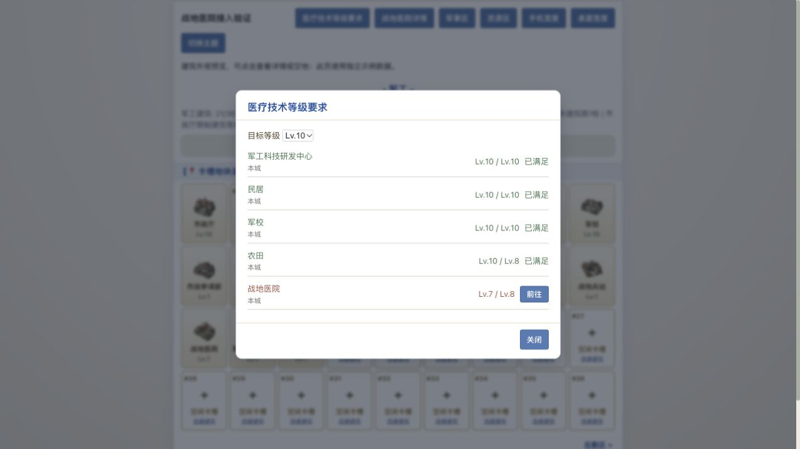

# 战地医院接入验证（2026-10-12）

- 建筑：每城一座，军事区卡槽，最高10级；首建需本城市政厅3、民居1、军校1、农田1。
- 升级目标L：市政厅max(3,L)、民居max(1,L−1)、军校max(1,L−2)、农田ceil(L/2)。
- 医疗技术：原战地兵站条件改为战地医院，保留原等级曲线；10级医疗需本城医院8级。
- 医院入口连接现有伤兵营；回收率、治疗费用及旧伤兵规则保留。
- 在建等级、拆除中的降级、本城范围及已付费施工/研发队列的拆除保护均通过验证；旧科研快照仍依赖创建时的兵站条件。
- 完整配置可从零逐级建设至全部10级，无升级死锁；运行配置与设计配置一致，其他建筑及科技规则与改动前一致。
- 图标已升级为专属 3D 写实微缩模型（红十字双坡诊疗主楼+野战救治帐篷+救护车），比选与资产处理详见 output/imagegen/field-hospital-20261012/，脚本为 scripts/assets/prepare-field-hospital.py。

## 自动验证

前端80项通过（其中医院新增6项）：

```sh
node --test frontend/tests/hospital.test.cjs frontend/tests/prerequisites.test.cjs frontend/tests/shipyard.test.cjs frontend/tests/build.test.cjs frontend/tests/tech.test.cjs frontend/tests/client.test.cjs frontend/tests/wounded.test.cjs
```

后端78项通过（其中医院新增7项），从backend目录运行：

```sh
JAVA_TOOL_OPTIONS='-Dfile.encoding=UTF-8' mvn -o -Dtest=FieldHospitalServiceTest,PrerequisiteIntegrationTest,BuildServiceTest,TechServiceTest,ShipyardServiceTest test
```

额外执行WoundedServiceTest时，8项通过，cityCombatRecordsBothSidesFromReportLossesIncludingDefeat在167行读取空战报列表报IndexOutOfBoundsException。将医院改动前的BuildingDef、BuildService及运行规则恢复到临时副本后，单独运行该测试仍在同一行复现。该失败为当前工作区已有问题，未改动城战或伤兵逻辑。

## 浏览器验证

以下使用独立示例数据，不提交玩家操作。医疗要求弹窗正确显示医院Lv.7 / Lv.8及前往按钮；点击后打开医院详情，显示升级的四项建筑前置和伤兵营入口；医院图片加载正常。




