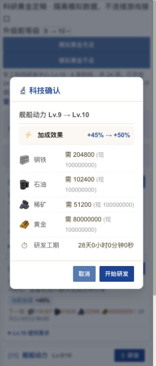
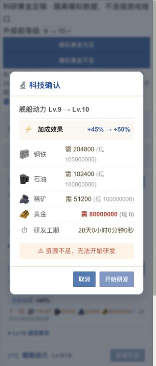

# 科研黄金定稿实施验收

日期：2026-10-28。规则：v6定稿。实施文档见[科研黄金消耗方案](../../docs/TECH_RESEARCH_GOLD_DESIGN_20261028.md)。

## 自动化验证

从仓库根目录执行以下命令；UTF-8环境确保含中文的工作区路径能被Maven正确读取。

```sh
LANG=en_US.UTF-8 LC_ALL=en_US.UTF-8 mvn -f backend/pom.xml -Dfile.encoding=UTF-8 -Dtest=TechnologyGoldCostsTest,TechnologyGoldCostsIntegrationTest,TechServiceTest,TechnologyReworkIntegrationTest,TechnologyReworkRulesTest,TechnologyReworkMigrationTest test
node --test frontend/tests/tech.test.cjs frontend/tests/prerequisites.test.cjs frontend/tests/resource-cap.test.cjs frontend/tests/resource-icons.test.cjs frontend/tests/build.test.cjs
LANG=en_US.UTF-8 LC_ALL=en_US.UTF-8 mvn -f backend/pom.xml -Dfile.encoding=UTF-8 -DskipTests package
```

结果：后端46项通过、失败/错误/跳过均为0；前端84项通过、失败/跳过均为0；构建成功。另通过修改脚本的 `node --check` 和定向 `git diff --check`，未运行自动格式化。

覆盖全部24项科技、每项10级，合计240个黄金价格与定稿JSON一致，累计2,019,962,000黄金。校验原四类资源公式未变、黄金不足不扣款、不建队列、五档末级从研发城扣款并保存快照、切城取消仍退研发城、旧队列按实扣退款且向下取整。

H2集成测试强制flush并清空持久化上下文后重读，五档末级均验证费用准确保存，城市黄金使用3,000,000,123的合成库存验证BIGINT路径；取消最高80,000,000黄金的科研后准确返还64,000,000。旧0黄金任务到期正常完成，既不补扣也不重复结算。

## 页面验收

使用现有前端静态服务和临时验收页，加载实际 `constants.js`、`data.js`、`icons.js`、`core.js`、`prerequisites.js`、`tech.js` 与原有主题样式。页面明确标注隔离模拟数据，不登录游戏、不调用游戏接口、不写真实账号记录；验收后移除临时HTML。

- 军事科技末级卡片显示30,000,000。
- 后勤四项资源产量科技末级卡片显示20,000,000。
- 机动三项末级卡片分别显示50,000,000、65,000,000、80,000,000。
- 舰船动力9→10确认弹窗显示80,000,000；黄金为0时显示资源不足并禁用“开始研发”。





## 生效边界

本次完成源码实施、构建和隔离验收，未重启或部署运行中的服务。部署新后端及前端入口和对应静态脚本后，新开工任务使用定稿价格；已有科研费用快照、工期和已完成科技保持原规则。无需数据库结构迁移。
