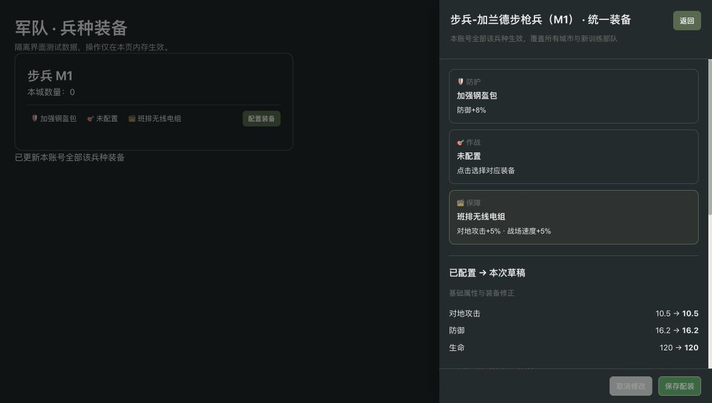
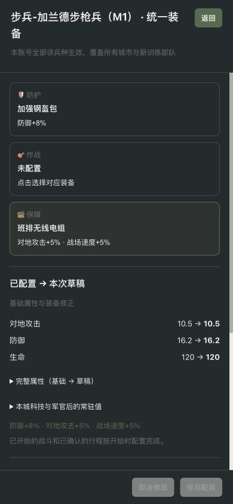

# 兵种装备实施验证记录

日期：2026-10-10。目录17兵种、68配方，摩托兵排除。保留设计初值，不改其他任务的基础兵种数值或旧测试断言。

## 验证范围与结果

| 验证 | 结果 |
| --- | --- |
| 真实backend工程装备专项 | 22/22通过：规则6、服务12、迁移1、并发2、54场平衡模拟1 |
| 前端相关测试 | 96/96通过，涵盖配装草稿、三槽保存、关闭、制造、库存推送、仓库、路线、战术和战报 |
| 当前主源码的隔离回归 | 218项，208通过，10失败，0错误 |
| 装备修正关闭对照 | 失败所在两类测试共66项，56通过，10失败；失败名称与断言结果完全相同 |
| 桌面/手机界面 | 实际前端模块+隔离数据验证：450px右侧抽屉，390×844手机全屏；正文无横向溢出、底部操作固定 |

隔离回归使用真实仓库主源码、资源和相关测试，独立target避免增量编译复用。对照仅在临时副本将 `UnitEquipmentEffects.percent` 置零，保留同一工作树其他数值与战术规则。该对照用于确认上述失败不随装备数值修正消失，不声称已完成整个历史工作树的改动前基线验证。

关键边界已覆盖：零兵数/跨城统一装备、扩军与全灭、返库、非法兵种和槽位、首次保存并发、重复发货与事务回滚、设施/科技门槛、取消退款、路线预览过期、运输机跨海运力、旧无路线采集、战损容量、途中换装、战中换装、历史战报和不同玩家援军配置。

## 重现命令

从仓库根目录执行（环境编码UTF-8）：

```sh
JAVA_TOOL_OPTIONS=-Dfile.encoding=UTF-8 mvn -q -f backend/pom.xml '-Dtest=UnitEquipment*Test' test
node --test frontend/tests/unit-equipment.test.cjs frontend/tests/depot.test.cjs frontend/tests/army-collapse.test.cjs frontend/tests/dispatch-route.test.cjs frontend/tests/headquarters.test.cjs frontend/tests/recon-car.test.cjs frontend/tests/tactical-facing.test.cjs frontend/tests/reports.test.cjs
```

重新导出模拟数据时，为同一Maven命令增加 `-Dunit-equipment.report=/绝对路径/balance.csv`。运行范围、预算和固定种子在 `UnitEquipmentBalanceTest` 中定义。

隔离回归的相关测试类为：BattleDamageTest、BattleMechanicsTest、BattleServiceTest、CommandBonusBattleTest、GuildSupportTest、MarchServiceTest、OfficerSkillCycleTest、ReconArmoredCarTest、TacticalBattleRoundTest、WildScoutTest，以及5个UnitEquipment测试类；主源码实际重新编译。对照只重跑BattleMechanicsTest和MarchServiceTest。

## 回归未通过的既有断言

当前兵种基础属性/贴脸伤害、射程、前排与技能说明已有其他修改，以下断言与当前实现不一致；关闭装备修正后仍得到相同结果。本任务未调整这些基础规则或断言。

| 测试 | 实际失败信息（开启与关闭装备修正一致） |
| --- | --- |
| `BattleMechanicsTest.bulwarkWorksInOfficerRounds` | expected: <282> but was: <471> |
| `BattleMechanicsTest.learningSkillUsesRoundSnapshotAndScalesWithEnemyAttack` | 非交战技能回合不应触发师夷长技 ==> expected: <343> but was: <571> |
| `BattleMechanicsTest.suppressionReducesEnemyAttackRatherThanItsOwner` | expected: <343> but was: <571> |
| `BattleMechanicsTest.weaponRangeTechnologyChangesActualReach` | expected: <null> but was: <infantry> |
| `BattleMechanicsTest.heavyTankProtectsGroundRearButDoesNotHideAircraftOrStopInfiltration` | expected: <rocket> but was: <htank> |
| `BattleMechanicsTest.militaryTechnologyDoublesBaseStatsAtLevelTen` | expected: <100> but was: <160> |
| `BattleMechanicsTest.defenseAndPiercingWorkForBothSidesAndWallOnlyProtectsCity` | expected: <240> but was: <400> |
| `BattleMechanicsTest.attackTechnologyAddsLinearDamageOutsideOfficerRounds` | expected: <343> but was: <571> |
| `MarchServiceTest.battleReportUsesRecipientPerspective` | expected: <首次交战回合触发，此后间隔两个回合再次触发（若第4回合首次交战，则在第4、7、10回合生效），全军攻击力额外+50%> but was: <首次交战回合触发，此后间隔两个回合再次触发（若第4回合首次交战，则在第4、7、10回合生效），全军攻击力额外+50%，仅本回合生效；主动攻击、余伤攻击与反击均适用，不放大师夷长技追加的攻击> |
| `MarchServiceTest.testWildGatherFlow` | 采集量应为min(1000, 500)=500 ==> expected: <500> but was: <1000> |

## 54场资源与科技模拟

[完整CSV](balance.csv)。预算5000/50000/500000，科技0/5/10，种子42。每种资源按1:1合计，包含征兵粮钢油稀矿和一次性制造费用；不计科研/建筑、时间、人口和持续养兵开支，因此是初值复核口径，不代表真实经济的等价值资源。

6组搭配为：裸步兵互战、钢盔轻机枪无线电步兵攻裸步兵、防护衣轻机枪无线电步兵攻裸步兵、裸步兵攻协同步兵、裸反坦克火箭车攻裸轻坦、裸反坦克火箭车攻间隔装甲主炮抗爆衬层轻坦。各组合同时记录胜负、初始/幸存兵数和回合数。当前战术规则最多24回合，超时攻方撤退并保留双方幸存者。

小预算中装备固定投入挤占兵力：5000预算、0科技，协同步兵85攻125裸步兵失败，守方余77。50000预算同条件，1210协同步兵攻1250裸步兵获胜，攻方余537。500000预算、10科技，12460协同步兵攻12500裸步兵获胜，攻方余5928。

抗爆衬层保留反坦克火箭车×3专项相克和15%减伤，但在高预算/科技时可延长交战至回合上限。500000预算、5科技，574反坦克火箭车攻1265裸轻坦获胜并余360；对1254抗爆轻坦则24回合后撤退，双方余29/113。10科技时同配装双方余5/230。保留计划初值，后续长期资源经济和所有军官技能组合仍需平衡观察。

## 界面证据与运行边界

截图来自实际 `unit-equipment.js/css` 与现有Constants/Data模块，API和库存使用隔离内存数据。验证了选择先形成草稿、保存后更新摘要、0兵数仍可配置、手机返回按钮不折行。没有对真实账号发起制造、配装或修改资源。





当前工程新增V85迁移，应用重新启动后自动执行；本次没有替用户部署或重启其他任务使用的游戏服务。当前行军只扣石油，轻机枪粮耗+5%为预留修正与明确提示，尚不扣款。旧客户端存档导入保留服务端配装和道具，仅清理制造订单，不从客户端JSON生成装备。

[完整设计](../../docs/UNIT_EQUIPMENT_DESIGN_20261010.md)
